<p align="center">
  <a href="https://teleoffice.ai/">
    <picture>
      <source srcset="docs/assets/readme/hero-dark.webp" media="(prefers-color-scheme: dark)">
      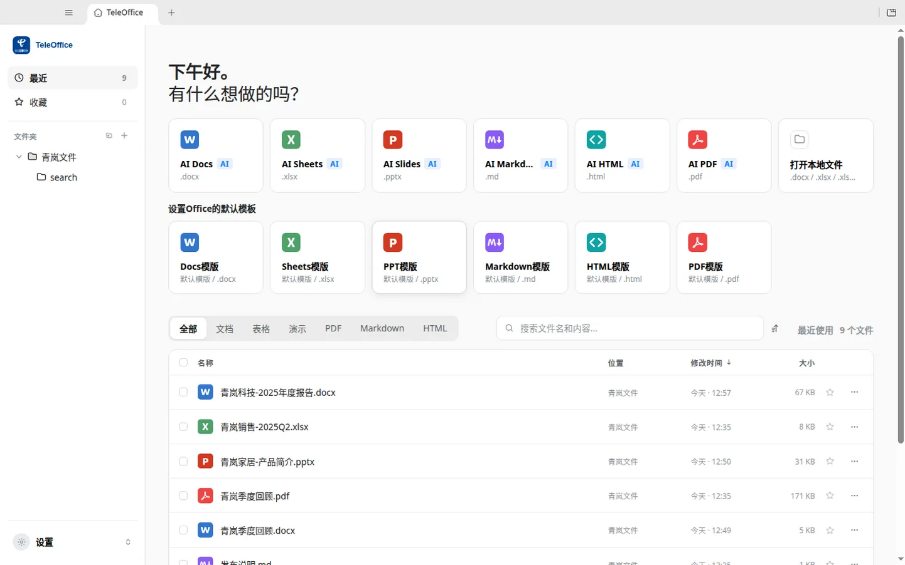
    </picture>
  </a>
</p>

<h1 align="center">TeleOffice</h1>

<p align="center"><b>功能完整的开源 AI 办公套件。</b><br>
Word、Excel、PowerPoint 和 PDF 文件，由你和 AI 一起编辑，并以原来的格式保存。</p>

<p align="center">
  <a href="#download"><b>下载</b></a> ·
  <a href="#command-line-and-agent-skill"><b>命令行</b></a> ·
  <a href="#mcp-server"><b>MCP</b></a> ·
  <a href="https://teleoffice.ai/"><b>官网</b></a> ·
  <a href="https://teleoffice.ai/join"><b>社区</b></a> ·
  <a href="PRIVACY.md"><b>隐私</b></a>
</p>

TeleOffice 是免费、开源的 Microsoft Office 替代品，支持 macOS、Windows 和 Linux。它可以打开并保存原生 `.docx`、`.xlsx` 和 `.pptx`，编辑 PDF、Markdown 和 HTML，并在每份文档旁边放一个 AI 面板。这个面板会读取文件、做出修改，并让你看到改了哪里。

- **原生格式，按字节保留。** 只有你改过的部分会被重写。文件里其余内容逐字节保留，所以文档回到 Word、Excel 和 PowerPoint 里仍然可用。
- **AI 的修改可以审阅。** 改动以修订痕迹和差异出现，可以整轮回滚。表格里写入的是会重新计算的公式，不是贴进去的数字。幻灯片和网页生成到画布上之后，仍然可以继续改。
- **文件留在本机。** 打开、编辑、保存和转换都在你的电脑上完成。PDF → Word / Excel / PowerPoint、Markdown → Word、HTML → Word 都在本地运行。只有 AI 调用会发到你选择的服务商。
- **按内容找文件。** 首页会搜索文件名、文件夹和正文。`.docx`、`.xlsx`、`.pptx`、PDF、Markdown 和 HTML 都进入本机 SQLite 全文索引，中文也可以检索。需要时，前若干条结果还可以交给 **[TypeSafe Jev](https://typesafe.ai/)** 按相关性重排。
- **用自己的密钥。** 在设置里填写 Claude、OpenAI、Gemini、DeepSeek、Kimi、GLM、Qwen、Doubao、MiniMax、Grok、Mistral、OpenRouter、Requesty、Opper 的密钥，或任何 OpenAI 兼容端点，包括本机模型服务。搜索和生图也可以走本机命令行。
- **可以脚本化，也可以交给编程助手。** 应用自带 `teleoffice` 命令行，以及一份给 Claude Code、Codex、Cursor、Gemini CLI、GitHub Copilot、OpenCode 和 Windsurf 用的 skill。编程助手不必打开窗口，就能在这台电脑上创建、转换、读取和编辑真正的 Office 文件。

**获取：** [macOS](https://github.com/tyonger-stack/Teleoffice/releases/latest)（Apple Silicon 和 Intel）·
[Windows](https://github.com/tyonger-stack/Teleoffice/releases/latest)（x64 和 Arm）·
[Linux](https://github.com/tyonger-stack/Teleoffice/releases/latest)（deb、rpm、AppImage）——
系统要求见[下载](#download)。

## 界面

下面的图都是当前 TeleOffice 桌面程序在 Linux 上的真实窗口，界面语言为简体中文。浅色和深色主题只改变屏幕上的外观；导出、打印和保存的文件仍使用文档自己的颜色。

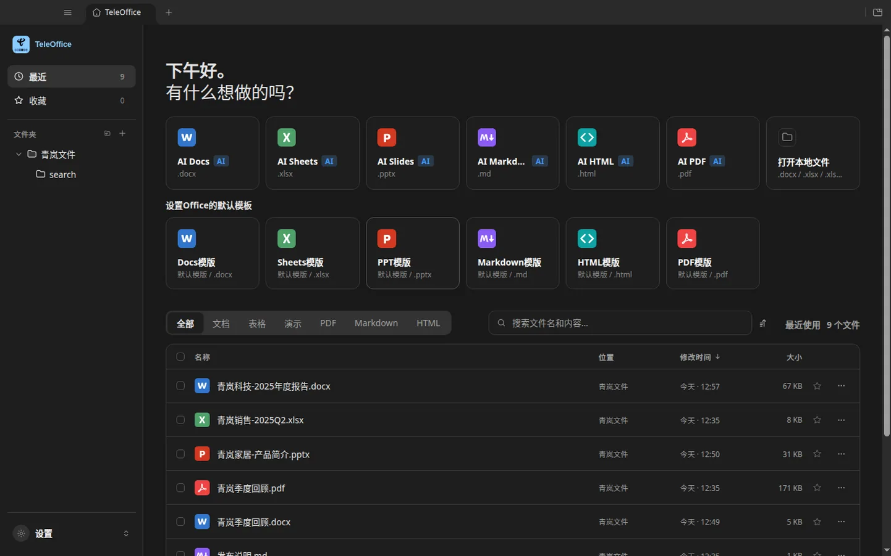

首页可以新建 Docs、Sheets、Slides、Markdown、HTML 和 PDF，也可以从默认模板开始，或打开本地文件。最近使用的文件按修改时间列出。搜索框同时查文件名和正文。在“设置Office的默认模板”里点“PPT模版”，可在菜单中设置或取消默认 PPT 模板。

### 1 · Docs —— 打开并编辑 `.docx`

<table>
<tr>
<td width="50%">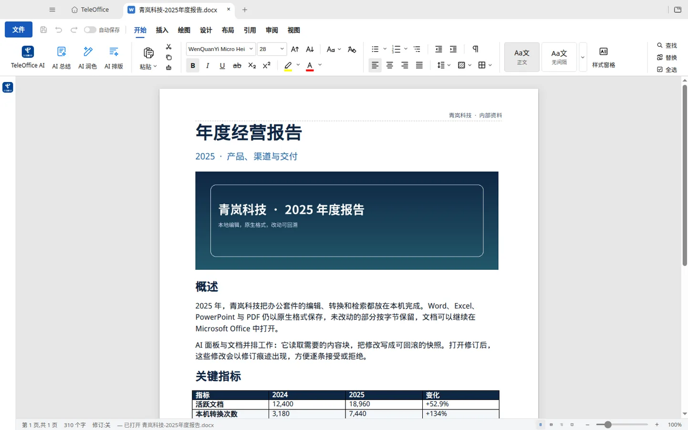</td>
<td width="50%">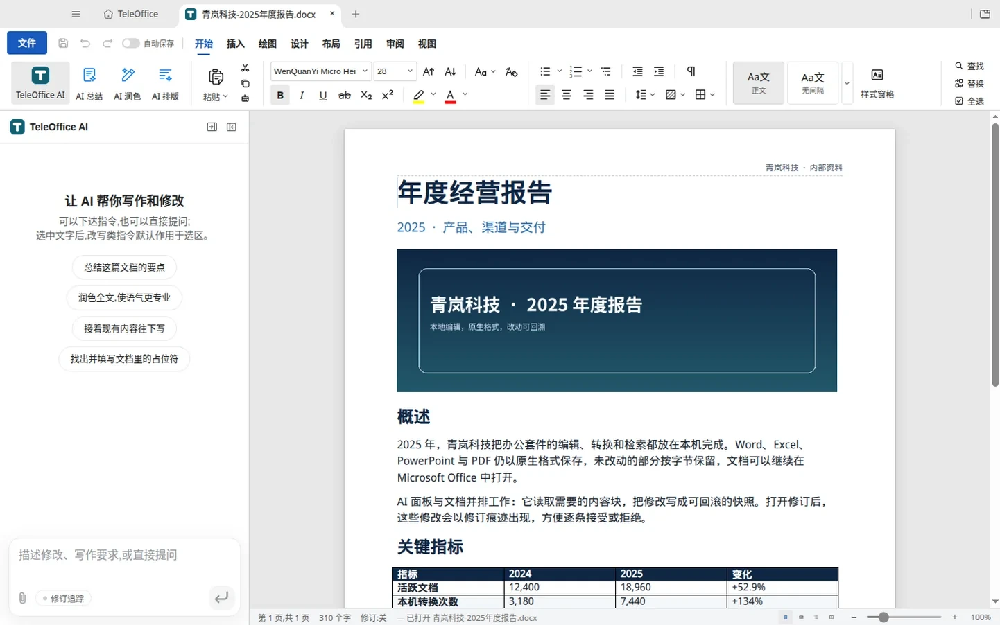</td>
</tr>
<tr>
<td><b>按页面打开。</b>标题、图片、底纹表格、页眉和页脚留在版心上。收起 AI 面板后，文档占满编辑区。样式、批注、修订、公式和墨迹在往返时保留。</td>
<td><b>在旁边改。</b>面板里的提示可以直接总结、润色或续写；也可以自己输入。每一轮都可以回滚。打开<b>修订追踪</b>后，改动会以修订形式出现。</td>
</tr>
</table>

### 2 · Sheets —— `.xlsx` 里的公式和图表

<table>
<tr>
<td width="50%">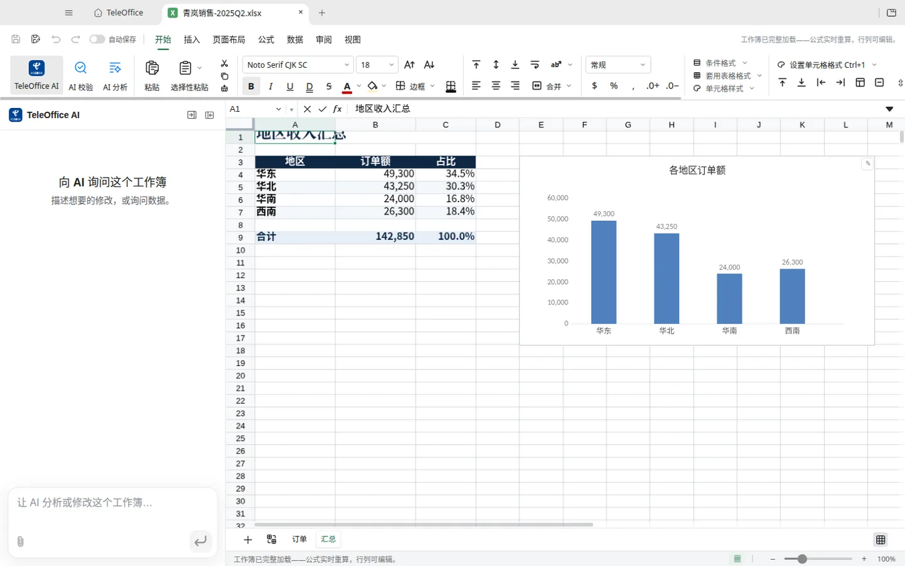</td>
<td width="50%">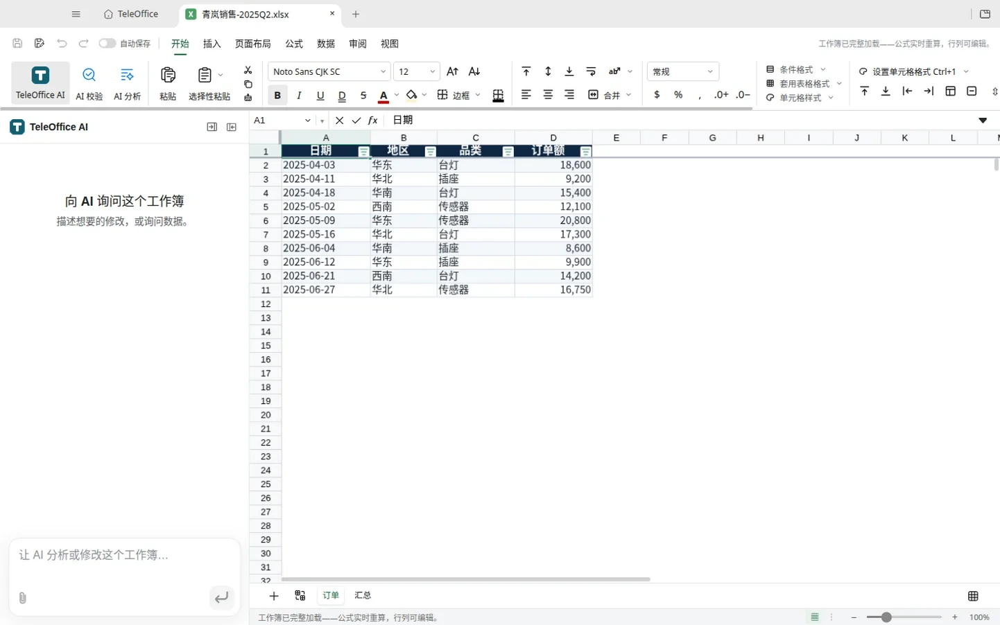</td>
</tr>
<tr>
<td><b>汇总是算出来的。</b>各地区订单额使用 <code>SUMIF</code>，占比引用合计。柱状图跟这四行数据走。工作簿加载完成后，公式会在本机重算。</td>
<td><b>明细还在原来的表里。</b>订单表保留筛选。AI 面板可以针对这个工作簿提问；回答里的单元格引用可以点回去。底层是自研的 Rust <code>.xlsx</code> 引擎，支持数据透视表、切片器、条件格式和公式追踪。</td>
</tr>
</table>

### 3 · Slides —— 打开并继续改 `.pptx`

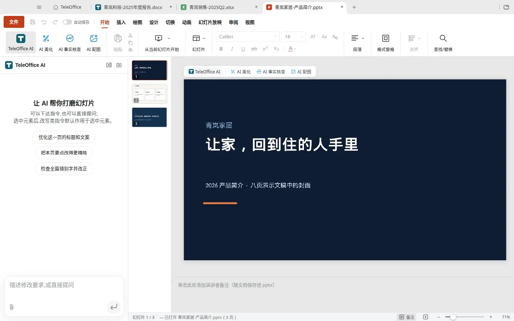

<table>
<tr>
<td width="50%"></td>
<td width="50%">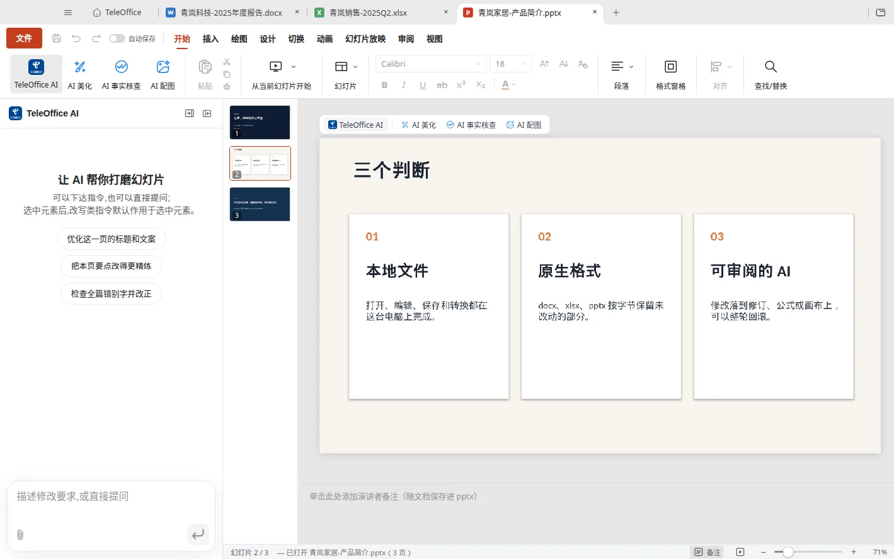</td>
</tr>
<tr>
<td><b>封面、缩略图和面板在同一个窗口。</b>可以从一句提示生成文稿，也可以打开已有的 <code>.pptx</code>。母版、版式、智能参考线和裁剪都还在。</td>
<td><b>每一页都还能改。</b>选中对象后，面板上的提示作用于这一页。也可以让它重排、改写或换成另一种版式。</td>
</tr>
</table>

### 4 · PDF —— 阅读、改字，并在本机转成 Word

<table>
<tr>
<td width="50%">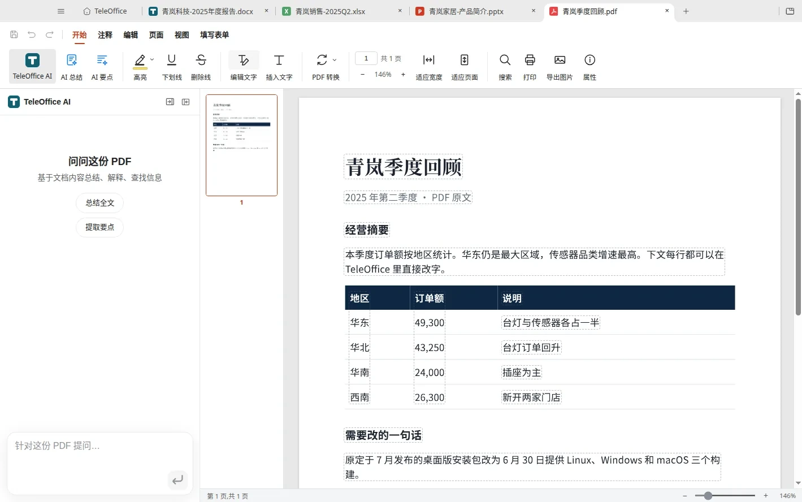</td>
<td width="50%">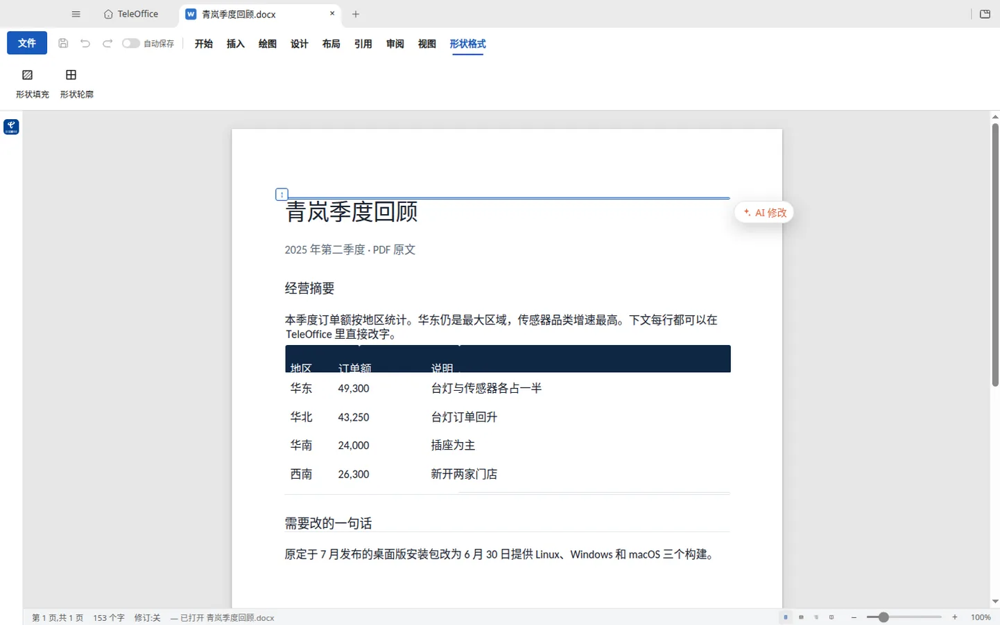</td>
</tr>
<tr>
<td><b>在页面里改字。</b>「编辑文字」重写页面内容流，并尽量沿用原来的字体，而不是盖一层注释。就长文档提问时，回答可以带页码。</td>
<td><b>转换在本机完成。</b>PDF 转 Word 得到可编辑的 <code>.docx</code>，在 Docs 里打开。转 Excel、转 PowerPoint 走同一条路径。扫描页在 macOS 和 Windows 上可以由系统 OCR 识别。</td>
</tr>
</table>

### 5 · HTML —— 单文件页面，先定方向再改样式

说明页面给谁用、要做什么。AI 可以先给出设计方向，再写成一份自包含的 `.html`。预览、分栏和源码在同一条工具栏上。

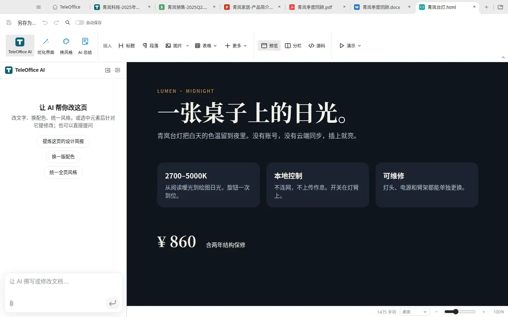

<table>
<tr>
<td width="50%"></td>
<td width="50%">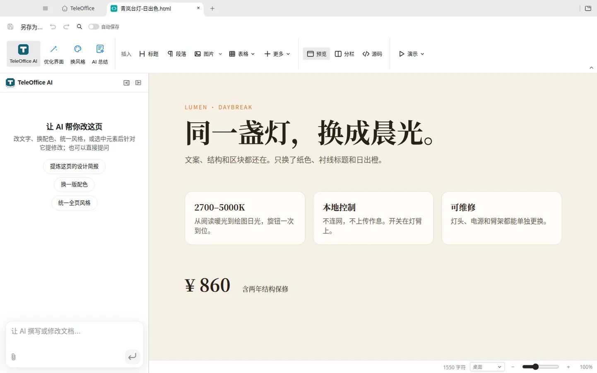</td>
</tr>
<tr>
<td><b>预览就是这一份 HTML。</b>点元素可以改样式，双击可以改文字，也可以切到源码。面板里的「换一版配色」和「统一全页风格」对着当前页面。</td>
<td><b>结构和文案可以留下，只换方向。</b>全屏演示，或导出成 PDF，或导出成可编辑的 Word 文档。</td>
</tr>
</table>
<table>
<tr>
<td width="50%">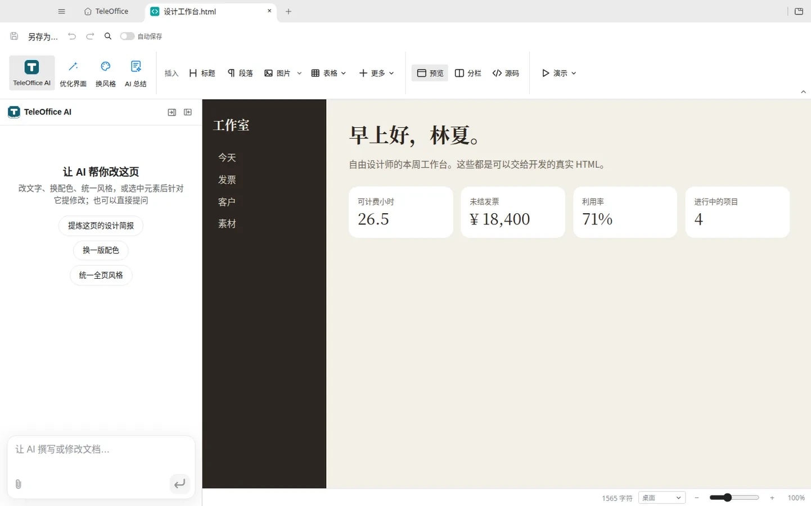</td>
<td width="50%">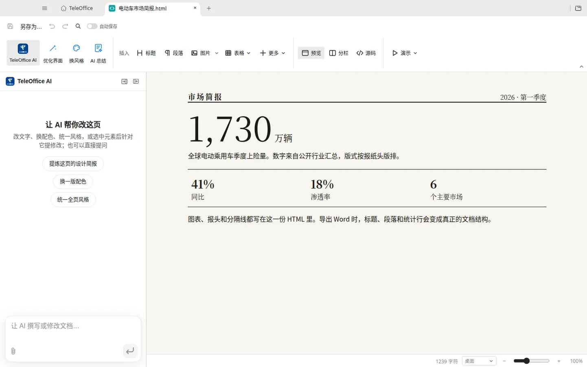</td>
</tr>
<tr>
<td><b>界面稿也是 HTML。</b>导航、问候和指标卡片都在这一份文件里，可以直接交给开发。</td>
<td><b>数据页同样是一份 HTML。</b>报头、大数字和统计行在导出 Word 时会变成标题、段落和表格；图表这类没有对应结构的部分会嵌成图片。</td>
</tr>
</table>

### 6 · Markdown —— 块编辑器，选中后可以改写

<table>
<tr>
<td width="50%">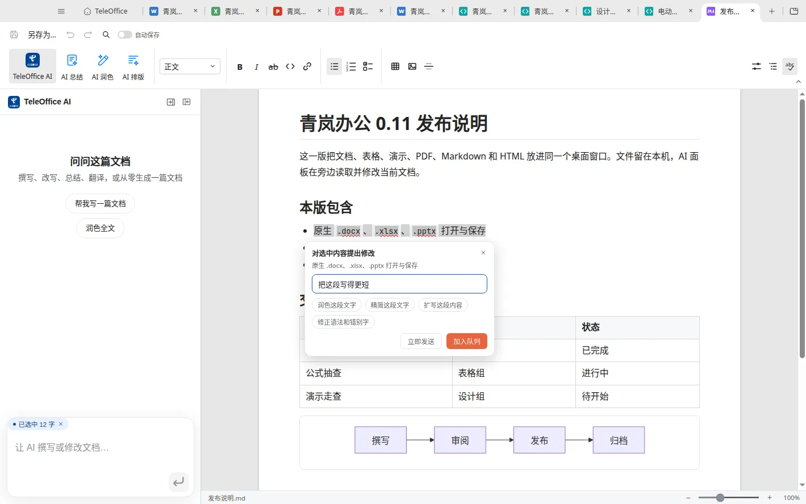</td>
<td width="50%">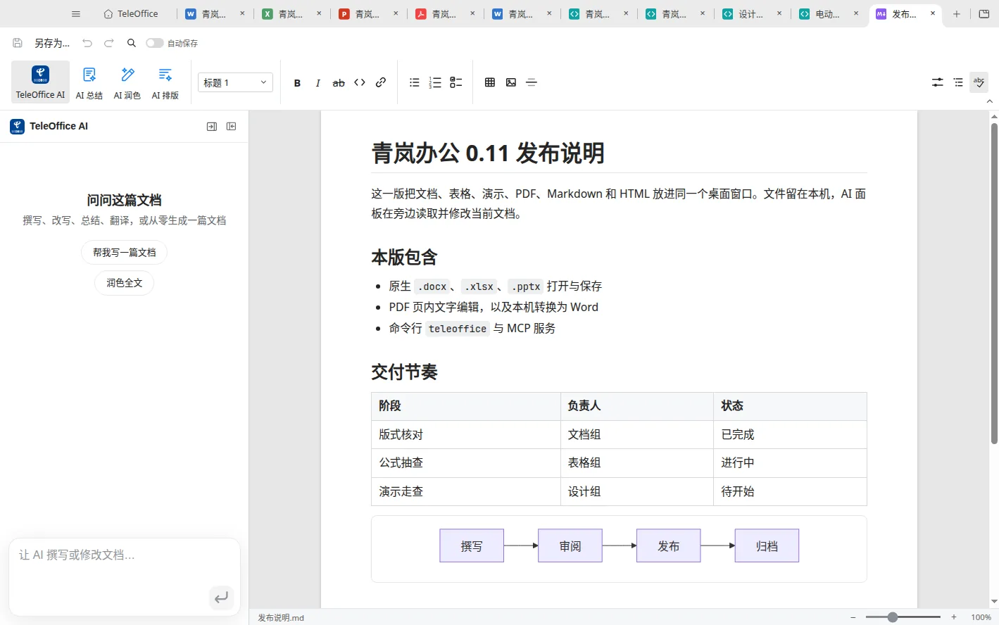</td>
</tr>
<tr>
<td><b>选中再改。</b>选中段落后出现修改入口。可以马上发送，也可以把几处修改放进队列，一次执行。Docs 里同样有这个入口，按钮写的是「AI 修改」。</td>
<td><b>看起来是排好的，存盘仍是 <code>.md</code>。</b>标题、列表、表格、图片、代码块和 Mermaid 图都在编辑器里。Markdown 转 Word 在本机完成。</td>
</tr>
</table>

### 7 · 搜索 —— 先按正文找，再按需要重排

工作文件夹里的文件会在本机建索引：文件名、路径，以及 Word、Excel、PowerPoint、PDF、Markdown 和 HTML 的正文。索引在 SQLite 里，中文按词切分。

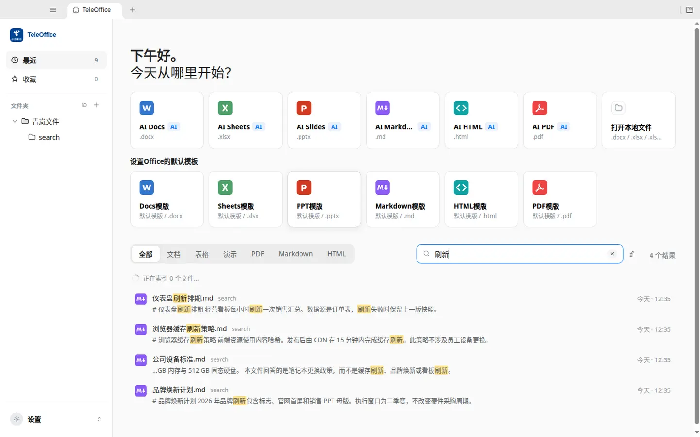

<table>
<tr>
<td width="50%">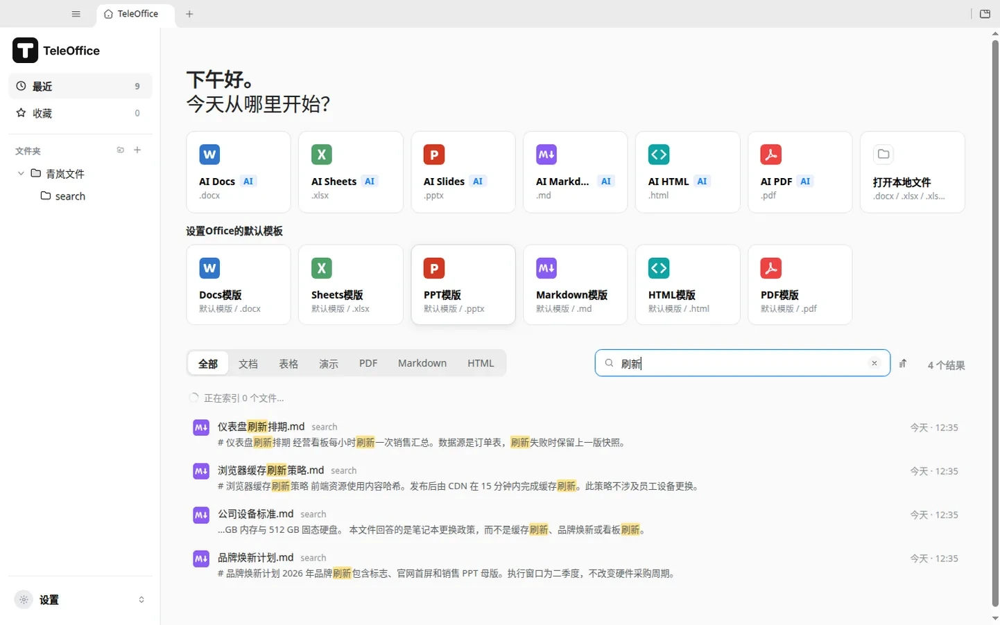</td>
<td width="50%">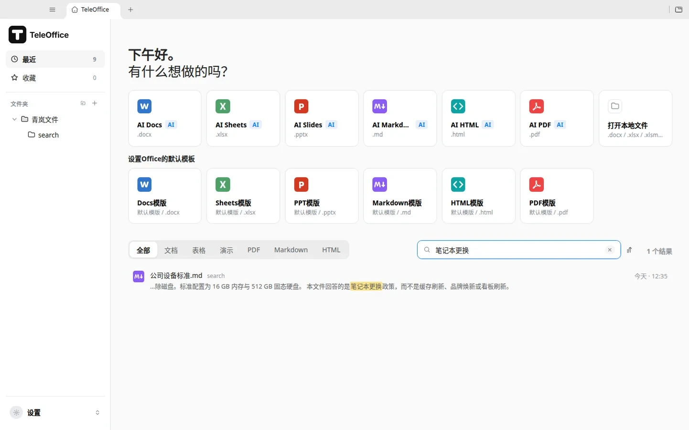</td>
</tr>
<tr>
<td><b>同一个词会命中很多文件。</b>「刷新」同时出现在缓存策略、看板排期和品牌计划里。设备标准也会出现，因为它的正文写了自己不是缓存刷新。</td>
<td><b>问得更具体，结果就收窄。</b>「笔记本更换」留下的是写明三年更换周期的那一份。索引不出本机。</td>
</tr>
</table>


**Jev 搜索重排**在「设置 → 生图、媒体与搜索 → 本机文件搜索」。默认关闭。打开后，前 20 条命中的片段会发给 [TypeSafe Jev](https://typesafe.ai/blog/introducing-system-one-models-and-jev) 打分并排序。端点可以选 OpenRouter（模型 `typesafe/jev-1.13`）或 TypeSafe 自己的 API。密钥只存在这台设备上。调用失败或超时时，仍使用本机原来的顺序。结果旁会出现 Jev 标记，表示这次顺序来自模型。

### 8 · 命令行 —— 编程助手在本机驱动同一套引擎

TeleOffice 带有 `teleoffice` 命令行和一份 agent skill。装上 skill 之后，Claude Code、Codex、Cursor、Gemini CLI、GitHub Copilot、OpenCode 或 Windsurf 可以用和应用相同的引擎创建、转换、读取和编辑 Office 文件，不必打开窗口。

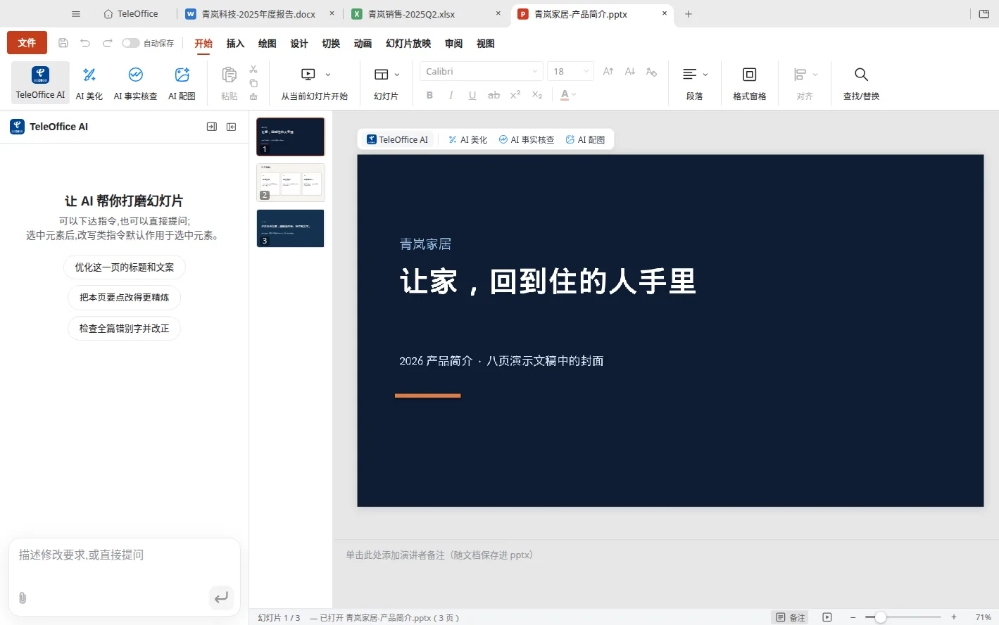

<table>
<tr>
<td width="50%"></td>
<td width="50%"></td>
</tr>
<tr>
<td><b>助手按 skill 里的步骤做。</b>它会先读指南，再写样式、大纲和每一页的规格。<code>teleoffice slides check</code> 会拦住溢出和重叠，<code>teleoffice create</code> 组装 <code>.pptx</code>，<code>slides render</code> 交回每一页的 PNG。</td>
<td><b>在设置 → 集成里安装。</b>这里只列出这台电脑上检测到的助手。也可以下载 zip，或运行 <code>npx skills add tyonger-stack/Teleoffice</code>。命令见<a href="#command-line-and-agent-skill">命令行与 agent skill</a>。</td>
</tr>
</table>

### 9 · MCP —— 同一套工具走 Model Context Protocol

每条 `teleoffice` 命令也是一个 MCP 工具。Claude Code、Claude Desktop、Cursor 和其他 MCP 客户端可以自己启动 `teleoffice mcp`，不必安装 skill，也不必打开窗口。当前是 34 个工具，另外还有操作参考文档资源。应用里的 HTTP 服务则可以在一个看得见的 Word 标签页里生成文档。


<table>
<tr>
<td width="50%">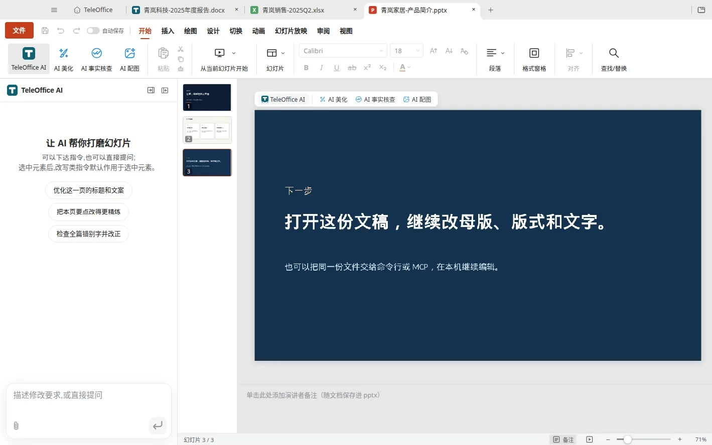</td>
<td width="50%"></td>
</tr>
<tr>
<td><b>助手直接调用工具。</b>检索、读指南、逐页检查、组装 <code>.pptx</code>、审计版式、渲染 PNG、替换某一页，都是 MCP 工具的返回值。只有搜索和媒体请求会离开本机。</td>
<td><b>在设置 → 集成 → MCP 里复制配置。</b>Claude Code 用一行 <code>claude mcp add</code>。Cursor、Claude Desktop 和其他客户端粘贴 JSON。本地 HTTP 服务用来在看得见的 Word 标签里生成。说明见 <a href="#mcp-server">MCP 服务器</a>。</td>
</tr>
</table>

## 为什么用 TeleOffice

- **开源**，Apache-2.0，在 GitHub 上开发。
- **在你的电脑上运行。** macOS、Windows 和 Linux 都有原生应用。文件在本地磁盘上，编辑、保存和转换都在本机。
- **真正的 Office 文件。** 原生 `.docx`、`.xlsx` 和 `.pptx`。没改过的部分按原样复制。
- **AI 改的是文档本身。** Docs 里是修订，Sheets 里是公式和图表，Slides 里是画布上的对象。每一轮都可以回滚。
- **模型和密钥由你决定。** 使用 Claude、OpenAI、Gemini、DeepSeek 等的密钥，也包括本机服务和任何 OpenAI 兼容端点。
- **PDF 按页面处理。** 可以在页内改文字，也可以在本机把 PDF 转成 Word、Excel 或 PowerPoint。扫描件可以使用系统 OCR。
- **Markdown 和 HTML 用同一个 AI 面板**，并可以在本机导出为 Word。
- **搜索找的是内容，不只是文件名。** 文件夹里的文档在本机建全文索引。需要时用 TypeSafe Jev 重排。
- **可以交给助手。** 命令行、skill 和 MCP 把同一套引擎提供给 Claude Code、Claude Desktop、Codex、Cursor 和其他助手，计算仍在本机。
- **免费**，个人和团队都可以用。

## AI 后端

**搜索和媒体默认走本机命令行。** 在「生图、媒体与搜索」里没有另选服务商时，网页搜索使用这台电脑上的两个命令行：中文查询和中文站点走 MiniMax CLI（`mmx`），其余走 Antigravity CLI（`agy`），一方失败就换另一方。图片生成、图片/音频/视频解析和语音识别先试 `agy`，再试 `mmx`；语音合成和视频使用 `mmx`。两个命令行都没有时，网页搜索改用 Parallel 的免费 Search MCP，然后再用 DuckDuckGo。生图和媒体解析可以在同一页改用其他服务商。

**自带密钥。** 「设置 → AI 模型」列出 Claude、OpenAI、Gemini、DeepSeek、Kimi、GLM、Qwen、Doubao、MiniMax、Grok、Mistral、OpenRouter、Requesty、Opper 和 OpenCode Zen/Go，另有一个自定义槽位，可填任何 OpenAI 兼容端点（Base URL 和密钥），包括本机模型服务。搜索和媒体在「生图、媒体与搜索」里按能力分开配置：网页搜索可选 Serper、Serply、Tavily 或 Parallel；生图和图片/视频解析可选 OpenAI、Gemini、Doubao/Seedream、GLM、Grok、Qwen、MiniMax，或任何 OpenAI 兼容的图片端点。图片解析还可以用 DeepSeek V4.1 Flash。

**TypeSafe Jev** 用来重排首页的文件搜索。在「生图、媒体与搜索 → 本机文件搜索」打开 Jev 搜索重排，并选择端点：[OpenRouter](https://openrouter.ai/typesafe)（模型 `typesafe/jev-1.13`）或 TypeSafe 自己的 API。密钥只保存在本机。默认关闭。打开之后，离开本机的只有前 20 条命中的片段。

**Parallel** 的免费 Search MCP 不需要账号，有速率限制。本机命令行没有给出结果时，它排在 DuckDuckGo 抓取之前。在网页搜索里选中 Parallel 并填写 [Parallel](https://platform.parallel.ai/) 密钥后，则改走 Search API。

整套应用有浅色、深色和跟随系统三种主题。主题只改变屏幕。导出、打印和保存的文件始终使用文档自己的颜色。

<a id="command-line-and-agent-skill"></a>

## 命令行与 agent skill

应用能对文件做的事，`teleoffice` 在终端里也能做：检查、转换、创建、读取和编辑 Word、Excel、PowerPoint、PDF、Markdown 和 HTML，用的是同一套引擎，没有界面。它随 TeleOffice 安装，不需要单独的运行时，也不会把文档发走。配上 **agent skill** 之后，编程助手可以交出真正的 Office 文件。

**可以直接用的助手：** Claude Code、Codex、Cursor、Gemini CLI、GitHub Copilot、OpenCode 和 Windsurf。其他能读取 skill 的助手也可以。Claude Desktop 和所有 MCP 客户端走 [MCP 服务器](#mcp-server)。

### 安装 skill

| 方式                                      | 效果                                                                                                              |
| ----------------------------------------- | ----------------------------------------------------------------------------------------------------------------- |
| 应用里的 **设置 → 集成**                  | 列出这台电脑上找到的助手。点一次，就把 skill 写进选中的那些。TeleOffice 更新带了新 skill 时，旁边会出现**更新**。 |
| 同一页的 **下载 skill（zip）**            | claude.ai、Claude 桌面应用和其他助手可以上传的目录结构。                                                          |
| `npx skills add tyonger-stack/Teleoffice` | 从本仓库安装到兼容 skills 的助手。                                                                                |

然后新开一个对话，让它做一份文档。skill 会告诉助手何时该用 `teleoffice`、改之前要先读文件，以及怎样检查结果。

### 在终端里试

```bash
teleoffice --version
teleoffice info report.docx --json                  # 标题和块；表格、幻灯片、页数也走 info
teleoffice convert report.md --to pdf               # md/html/docx/xlsx/pptx → pdf，pdf → docx/xlsx/pptx
teleoffice create --type docx --from notes.md --out notes.docx
teleoffice create --type xlsx --from table.json --out sales.xlsx   # "=SUM(B2:B9)" 仍是公式
teleoffice docs read report.docx --range 0-9 --json # 然后用 docs apply --ops edits.json 原地修改
teleoffice render report.docx --out shots/          # 每页一张 PNG
teleoffice open sales.xlsx                          # 把结果交给编辑器
```

每条命令默认打印一行摘要。加上 `--json` 则输出一个 JSON 对象。编辑是原子的：被拒绝的操作不会改文件，并带回可操作的错误说明。`teleoffice help` 列出当前命令。完整说明在 [packages/cli/README.md](packages/cli/README.md)。

### 助手实际会跑什么

做一份演示文稿时，助手按 skill 的分阶段流程推进。CLI 在进入下一步之前检查这一阶段：

```bash
teleoffice capabilities --json                        # 这台 TeleOffice 配了哪些外部能力
teleoffice guide slides design                        # 文稿流程和版式
teleoffice image "…" --aspect 16:9 --out deck/assets/cover.jpg
teleoffice slides check deck/outline.json --json      # 先检查大纲
teleoffice slides check deck/pages/01.json --json     # 做一页，检查溢出和重叠
…                                                    # 每一页一个文件，直到检查通过
teleoffice create --type pptx --spec deck/pages --outline deck/outline.json --out deck/deck.pptx --json
teleoffice slides render deck/deck.pptx --out deck/shots --json
teleoffice slides audit deck/deck.pptx --json
teleoffice slides replace deck/deck.pptx --slide 4 --spec deck/pages/05.json --json
teleoffice open deck/deck.pptx
```

CLI 也可用 `teleoffice template default <名称>` 设置已登记的 PPT 模板，或用 `teleoffice template add <名称> <文件.pptx> --default` 登记并设为默认；`teleoffice template default --clear` 可清除。创建 deck spec 时，在页面版式名称与默认模板兼容时会自动套用；未写版式的页面优先使用样例中出现过、内容占位符较少的标题版式，其次选装饰较丰富的简洁标题版式。`--no-template` 可关闭自动套用。

`teleoffice` 内部不调用模型。思考是助手的事，构建和检查是 CLI 的事。结果是一份普通的 `.pptx`，可以用 TeleOffice 或 PowerPoint 打开。

<a id="mcp-server"></a>

### MCP 服务器

这些命令也是 [Model Context Protocol](https://modelcontextprotocol.io) 工具，给不能开终端、或者你不想给终端的助手用。**设置 → 集成 → MCP** 里有可以复制的片段。接入方式有三种：

| 方式                             | 内容                                                                                                                                                                                                                                                                                                                                                                                                                                                                                                                   |
| -------------------------------- | ---------------------------------------------------------------------------------------------------------------------------------------------------------------------------------------------------------------------------------------------------------------------------------------------------------------------------------------------------------------------------------------------------------------------------------------------------------------------------------------------------------------------- |
| **A · `teleoffice mcp`**（推荐） | 助手自己启动的 stdio 服务。TeleOffice 不必开着。每条命令一个工具：`info`、`convert`、`create_docx`、`create_xlsx`、`create_pptx`、`create_pdf`、`docs_read` / `docs_apply` / `docs_check`、`sheet_*`、`slides_*`、`render`、`guide`、`search`、`image`、`media`、`open`，以及 `pdf_read`、`merge`、`template_list`、`template_inspect`、`capabilities`、`selection`。分阶段做演示文稿用 `deck_start` → `deck_page` → `deck_build` → `deck_replace`。操作、规格和 Markdown 以内联方式传入，没有文件系统的客户端也能用。 |
| **B · 本地 HTTP 服务**           | 跑在 TeleOffice 里面，地址是 `http://127.0.0.1:3093/mcp`（Streamable HTTP，兼容旧的 SSE）。工具驱动一个看得见的 Word 标签：`create_session`、`insert_content`、`replace_blocks`、`apply_ops`、`read_document`、`save_session`。默认关闭，在同一页设置里打开。                                                                                                                                                                                                                                                          |
| **C · `teleoffice mcp --http`**  | 把同一套 stdio 工具做成 Streamable HTTP，给另一台机器上的客户端用，例如容器、沙箱或局域网里的机器。文件随调用走：`PUT /files/<name>` 上传并返回 URL，工具的 `file` 参数接受 http(s) URL。写出文件的工具返回下载 URL；文件不大时，还会把字节放进 MCP 资源。`--host 0.0.0.0` 对网络开放，`--token` 用来保护。                                                                                                                                                                                                            |

```bash
# Claude Code
claude mcp add --transport stdio teleoffice -- teleoffice mcp
```

```jsonc
// Cursor、Claude Desktop 或其他 MCP 客户端
{ "mcpServers": { "teleoffice": { "command": "teleoffice", "args": ["mcp"] } } }
```

```bash
# 在安装了 TeleOffice 的机器上（局域网；共享机器请加 --token）
teleoffice mcp --http 3093 --host 0.0.0.0 --token "$TELEOFFICE_MCP_TOKEN"

# 客户端先上传，再把 URL 传给需要文件的工具
curl -T report.docx -H "Authorization: Bearer $TELEOFFICE_MCP_TOKEN" http://server:3093/files/
#   → { "url": "http://server:3093/files/<id>/report.docx", ... }
#   docs_read({ "file": "http://server:3093/files/<id>/report.docx" })
#   docs_apply(...) → output_url，用 curl -o 下载
```

HTTP 模式下，每个会话有自己的临时目录。相对路径和文稿目录都解析在这个目录里。不提供 `open`。没有设置 `TELEOFFICE_ALLOWED_ROOTS` 时，工具不能离开服务器自己的文件区。`render`、转 PDF 和 `create_pdf` 仍会启动一个隐藏的 TeleOffice 进程，所以无界面的主机需要安装应用，并有虚拟显示（`xvfb-run`）。

这里的 `teleoffice` 是应用自带的 CLI。macOS 上在 `/Applications/TeleOffice.app/Contents/Resources/cli/teleoffice`。设置页会打印你这台机器上的实际路径。服务器自带工作流说明，并把操作参考以 `teleoffice://guide/*` 资源暴露出来，所以不必再装 skill。skill 和 MCP 可以同时存在，由助手选择。`search`、`image`、`media` 仍走 TeleOffice 里配置的服务商。其余都在本机。`TELEOFFICE_ALLOWED_ROOTS` 把每个工具限制在你列出的文件夹里。

一份由 MCP 做成的演示文稿，从协议上看大致是：

```text
capabilities · guide(slides, spec) · guide(slides, design)
search(query)                        → 幻灯片要用的数字
search(query, images) · media(url, ask)
                                     → 候选图片，并确认是不是真实照片
deck_start(dir, style, outline)      → 大纲检查通过
deck_page(dir, n, page)              → 每一页对照大纲和配色检查
deck_build(dir, out)                 → 组装 .pptx
slides_audit(file) · slides_render(file, out)
                                     → 版式检查；每一页 PNG 作为图片内容返回
deck_replace(dir, n, page) · slides_render(file, out)
                                     → 看过渲染结果后再改某一页
```

助手可以不碰终端。数字、图片、指南、检查和渲染都作为工具结果返回。离开本机的只有 `search` 和 `media`，目的地是 TeleOffice 里配置的服务商。

<a id="download"></a>

## 下载

| 平台                                  | 系统要求                                               | 下载                                                                                      |
| ------------------------------------- | ------------------------------------------------------ | ----------------------------------------------------------------------------------------- |
| **macOS** —— Apple Silicon (arm64)    | macOS 11+                                              | [最新 `.dmg`（arm64）](https://github.com/tyonger-stack/Teleoffice/releases/latest)       |
| **macOS** —— Intel (x64)              | macOS 11+                                              | [最新 `.dmg`（x64）](https://github.com/tyonger-stack/Teleoffice/releases/latest)         |
| **Windows**（x64，大多数 PC）         | Windows 10+，Intel/AMD                                 | [最新 `-x64.exe` 安装程序](https://github.com/tyonger-stack/Teleoffice/releases/latest)   |
| **Windows** on Arm（ARM64）           | Windows 11 on Arm（Snapdragon X 及同类芯片）           | [最新 `-arm64.exe` 安装程序](https://github.com/tyonger-stack/Teleoffice/releases/latest) |
| **Linux** —— Debian / Ubuntu          | x86_64，glibc 2.34+（Ubuntu 22.04 或更新）             | [最新 `.deb`](https://github.com/tyonger-stack/Teleoffice/releases/latest)                |
| **Linux** —— Fedora / RHEL / openSUSE | x86_64，glibc 2.34+（Fedora 35+、RHEL 9+、Leap 15.6+） | [最新 `.rpm`](https://github.com/tyonger-stack/Teleoffice/releases/latest)                |
| **Linux** —— 其他发行版               | x86_64，glibc 2.34+，FUSE 2                            | [最新 `.AppImage`](https://github.com/tyonger-stack/Teleoffice/releases/latest)           |

构建来自 `main`。macOS 和 Windows 安装包已签名。旧版本在 [Releases](https://github.com/tyonger-stack/Teleoffice/releases)。

<details>
<summary><b>在 Linux 上安装</b></summary>

deb 用 apt 安装。它会拉上依赖，并把 TeleOffice 加到应用程序菜单：

```bash
sudo apt install ./teleoffice_<version>_amd64.deb
```

Fedora、RHEL 系列和 openSUSE 用 rpm：

```bash
sudo dnf install ./teleoffice-<version>.x86_64.rpm     # Fedora / RHEL 系列
sudo zypper install ./teleoffice-<version>.x86_64.rpm  # openSUSE
```

AppImage 直接运行。先安装 FUSE 2（`sudo apt install libfuse2`；Ubuntu 24.04 上的包名是 `libfuse2t64`），加上可执行权限，然后运行：

```bash
chmod +x TeleOffice-<version>.AppImage
./TeleOffice-<version>.AppImage
```

</details>

## 工作原理

七个 Electron 应用 —— Docs、Sheets、Slides、PDF、Markdown、HTML，以及多标签外壳 —— 共用一层纯 TypeScript 引擎，外加一个处理 `.xlsx` 的 Rust sidecar。原始文件始终是事实来源：修改以窄补丁应用，编辑器没碰到的部分在往返中保持原样。

```
open docx ─► 按哈希归档原件（不再改动这份归档）
          ─► 把 word/document.xml 解析成块树，每一块锚定到原来的 XML
          ─► Tiptap 编辑器（手动和 AI 编辑，并跟踪哪些块脏了）
save      ─► 脏块 → OOXML 片段（只引用已经存在的样式）
          ─► 拼回原来的 document.xml；没改的块保留自己的字节
          ─► 重新打包 zip；其他条目逐字节复制
```

各个包的说明（docx/pptx 引擎、`pdf2docx`、`html2docx`、助手核心和服务商）在 [CONTRIBUTING.md](CONTRIBUTING.md#engine-packages)。

## 开发

```bash
npm install
npm run fixtures     # 生成测试用的 .docx
npm test             # 引擎和应用的单元测试（docs/sheets/slides 不需要显示器）
npm run typecheck    # 每个工作区 tsc --noEmit
npm run dev          # 六个编辑器加外壳，对着 Vite 开发服务器
npm run dev:docs     # 只开一个应用（其他工作区同样）
npm run dist:mac     # 打 macOS dmg（会重新生成第三方声明）
npm run dist:win     # 打 Windows nsis 安装包
npm run dist:linux   # 打 Linux AppImage、deb 和 rpm
```

Sheets 的 xlsx sidecar 还需要 Rust 工具链（`cargo` 在 PATH 里）。`npm run build -w @teleoffice/sheets` 会编译它。每次改动要过的检查，以及拉取请求怎么合入，见 [CONTRIBUTING.md](CONTRIBUTING.md)。

## 社区

TeleOffice 还在积极开发，反馈会改变它。

- **报告缺陷或提出功能**，请到 [GitHub Issues](https://github.com/tyonger-stack/Teleoffice/issues)。
- **加入 TeleOffice 群聊**，在 [社区](https://teleoffice.ai/join) 和团队以及其他使用者交流。
- **给仓库加星。** 如果 TeleOffice 对你有用，这是支持这个项目最直接的方式。

## 常见问题

<details>
<summary><b>TeleOffice 免费吗？</b></summary>

免费，并且以 Apache-2.0 开源。应用本身没有试用期，也没有付费档。

</details>

<details>
<summary><b>能打开 Microsoft Word、Excel 和 PowerPoint 文件吗？</b></summary>

可以。TeleOffice 打开并保存原生 `.docx`、`.xlsx` 和 `.pptx`。保存按字节保留：没改过的部分逐字节写回，文档在 Microsoft Office 里仍然可用。

</details>

<details>
<summary><b>可以离线使用吗？</b></summary>

编辑完全在本地。打开、编辑、保存和转换都不会把文件发出去。AI 功能（助手、搜索、图片工具）需要网络，并需要可用的本机命令行，或你自己的模型 API 密钥。

</details>

<details>
<summary><b>能编辑 PDF 吗？</b></summary>

可以。文字和图片编辑会重写页面内容流，并保留原来的字体，而不是用注释盖住。

</details>

<details>
<summary><b>能把 PDF 转成 Word、Excel 或 PowerPoint 吗？</b></summary>

可以，而且完全在本机：PDFium 做字符级提取，再用几何信息分析版面。不上传。扫描页也支持：macOS 和 Windows 上由系统 OCR 读出文字，而不是留下一整页图片。

</details>

<details>
<summary><b>能用自己的模型或 API 密钥吗？</b></summary>

可以。TeleOffice 支持自带 Claude、OpenAI、Gemini、DeepSeek、Kimi、GLM、Qwen、Doubao、MiniMax、Grok、Mistral、OpenRouter、Requesty、Opper 和 OpenCode Zen/Go 的密钥，以及任何 OpenAI 兼容端点，包括本机模型服务。搜索、生图和图片/视频解析在「设置 → 生图、媒体与搜索」里使用各自的密钥，也可以走本机命令行。

</details>

<details>
<summary><b>能把 HTML 转成 Word 吗？</b></summary>

可以。HTML 里的「导出为 Word」在本机生成可编辑的 `.docx`。页面先在内置 Chromium 里渲染，再收成 Word 结构：标题、段落、列表、表格、卡片、指标行、表单和页面背景。图表、图标和装饰框这类没有对应结构的部分会嵌成图片。

</details>

<details>
<summary><b>能从 Claude Code、Codex、Cursor 或脚本里驱动吗？</b></summary>

可以。TeleOffice 会安装 `teleoffice` 命令行，无界面地跑同一套引擎。终端或脚本里可以检查、转换、创建、读取和编辑文档，`--json` 给程序用。agent skill 会教 Claude Code、Codex、Cursor、Gemini CLI、GitHub Copilot、OpenCode 和 Windsurf 使用它。请在 **设置 → 集成** 里安装。见[命令行与 agent skill](#command-line-and-agent-skill)。

</details>

<details>
<summary><b>会收集数据吗？</b></summary>

TeleOffice 不发送匿名使用统计。文档内容留在这台电脑上。只有使用 AI 功能时，才会把提示词和回答所需的文档上下文发给你配置的服务商。说明见 [隐私政策](PRIVACY.md)。

</details>

## 安全

进程方面的安排（渲染进程沙箱、IPC 校验、外部链接拦截）以及 AI 生成内容的威胁模型，见 [SECURITY.md](SECURITY.md)。

## 致谢

TeleOffice 用到这些开源项目：

- [Electron](https://www.electronjs.org/) —— 每个应用的桌面运行时。
- [Univer](https://github.com/dream-num/univer)（Apache-2.0）—— Sheets 扩展的电子表格界面内核。
- [PDFium](https://pdfium.googlesource.com/pdfium/)（BSD-3-Clause，经 [@embedpdf/pdfium](https://github.com/embedpdf/embed-pdf-viewer) 打包）—— PDF 文字和图片编辑用的内容流引擎。
- [pdf.js](https://github.com/mozilla/pdf.js)（Apache-2.0）和 [pdf-lib](https://github.com/Hopding/pdf-lib)（MIT）—— PDF 渲染和文档组装。
- [Tiptap](https://tiptap.dev/) / [ProseMirror](https://prosemirror.net/) —— Docs 和 Markdown 的块编辑器。
- [CodeMirror](https://codemirror.net/)（MIT）—— HTML 的源码编辑器。
- [Konva](https://konvajs.org/) —— Slides 和 Sheets 图表的画布渲染。
- [HarfBuzz](https://github.com/harfbuzz/harfbuzz)（wasm）—— 复杂文字的整形度量。
- [calamine](https://github.com/tafia/calamine) 和 [IronCalc](https://github.com/ironcalc/IronCalc) —— Rust xlsx sidecar 的读取和计算。
- [libeot](https://github.com/umanwizard/libeot)（MPL-2.0）—— 嵌入式 PowerPoint 字体的 MicroType Express 解码器，已移植为 TypeScript。
- [React](https://react.dev/)（MIT）—— 各应用的界面层。
- [Mermaid](https://mermaid.js.org/)（MIT）和 [KaTeX](https://katex.org/)（MIT）—— Markdown 和 Docs 里的图和公式。
- [opentype.js](https://opentype.js.org/)（MIT）—— 字体度量和字形查找。
- [JSZip](https://stuk.github.io/jszip/)（MIT）和 [fast-xml-parser](https://github.com/NaturalIntelligence/fast-xml-parser)（MIT）—— OOXML 容器和 XML。
- [Fluent UI System Icons](https://github.com/microsoft/fluentui-system-icons)（MIT）—— 功能区图标。
- [electron-updater](https://www.electron.build/)（MIT）—— 应用内更新。
- Liberation、Carlito、Caladea 和 Noto CJK 字体（OFL/Apache-2.0）—— 随应用带上的文档字体。

`npm run notices` 会重新生成随应用打包的第三方许可证摘要（`tools/gen-third-party-notices.mjs`）。运行时依赖为 MIT、Apache-2.0、BSD-3-Clause 或 OFL。

## 许可证

TeleOffice 使用 [Apache License 2.0](LICENSE)。例外是 `ee/` 目录，留给以后的企业模块，受 [TeleOffice 企业许可证](ee/LICENSE) 约束。

TeleOffice 的名称与标识是 Mainfunc, Inc. 的商标。Apache-2.0 并不授予使用它们的权利（见第 6 节）。分叉请使用自己的品牌。
