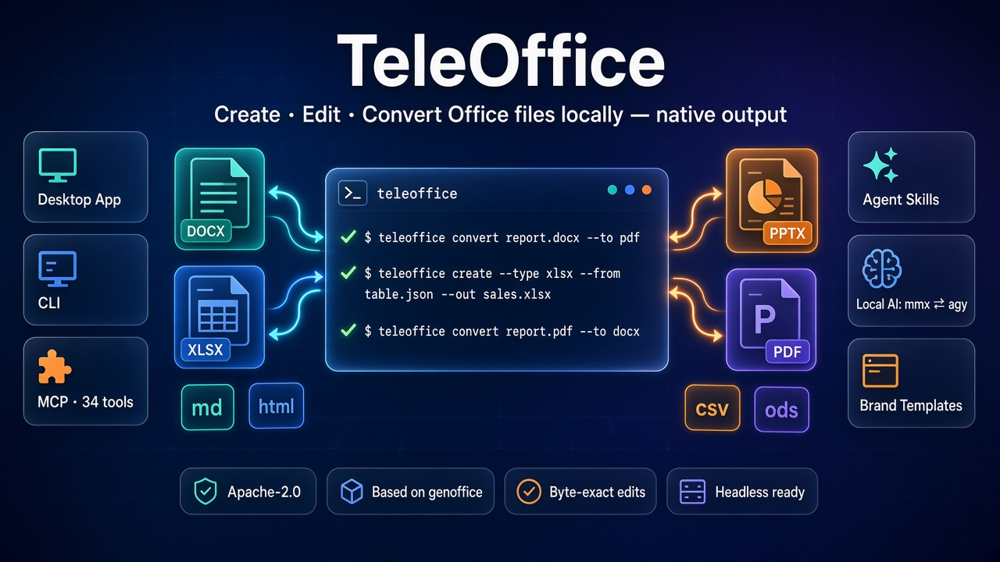
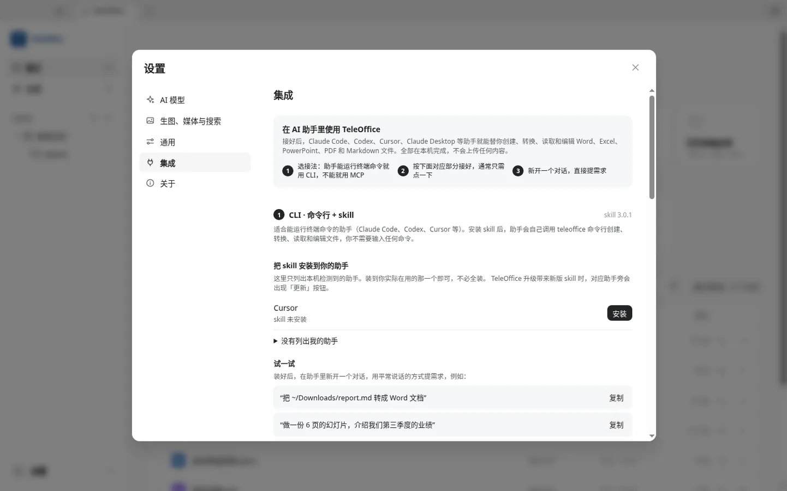
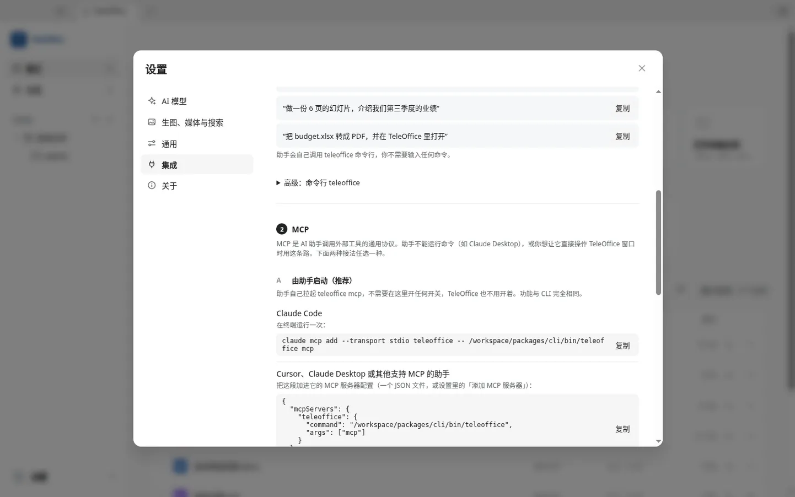
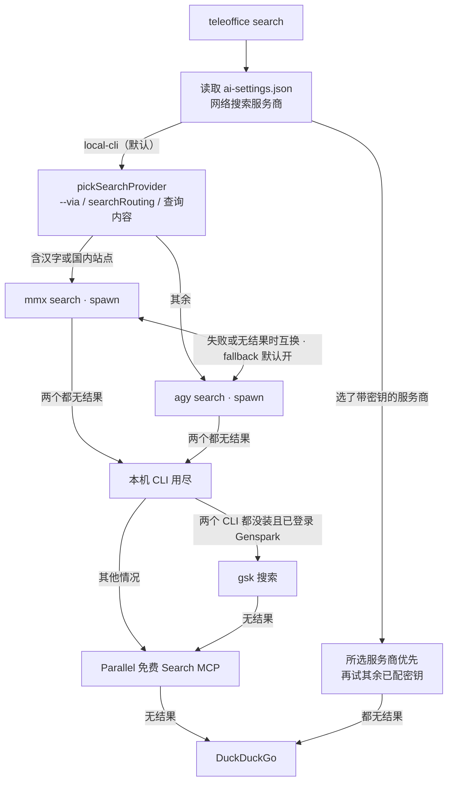
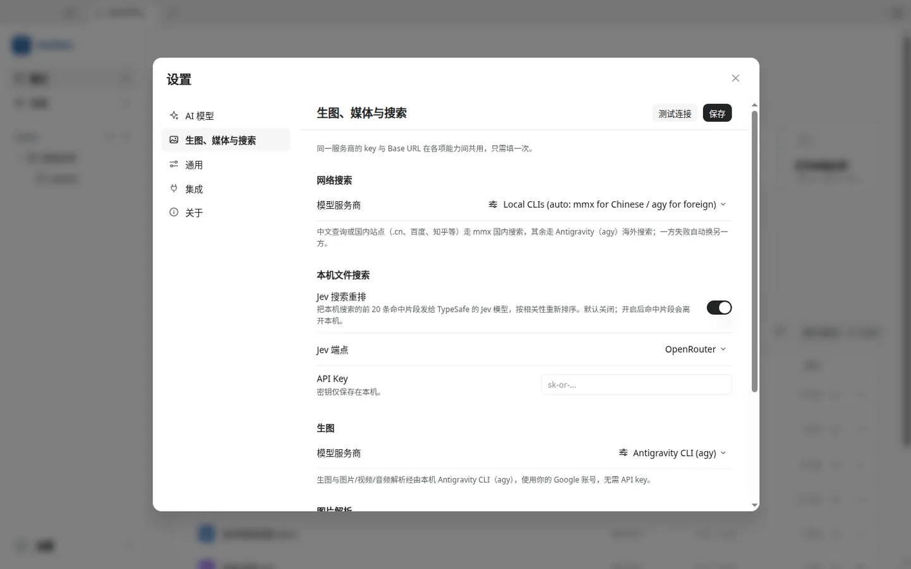
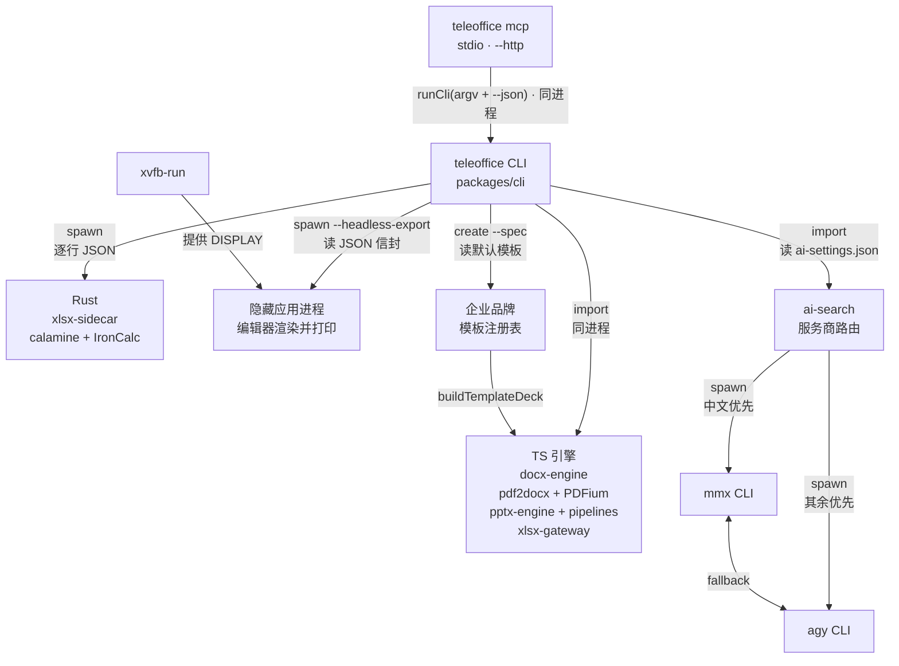
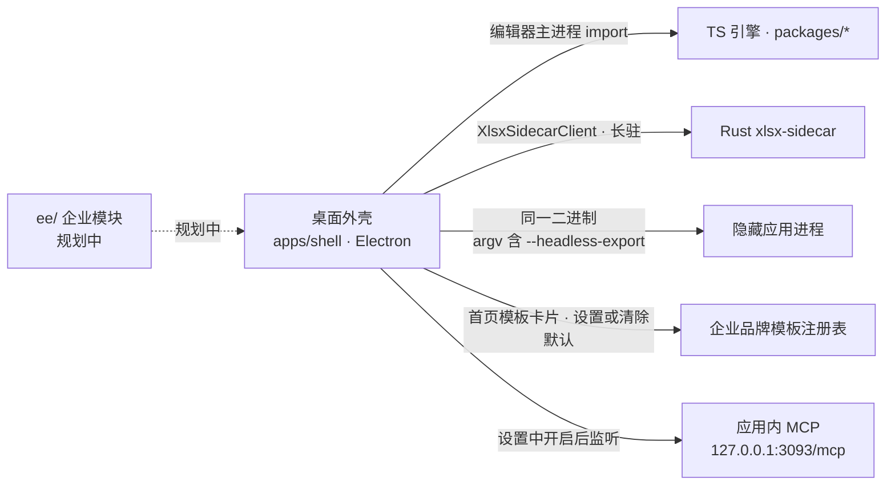
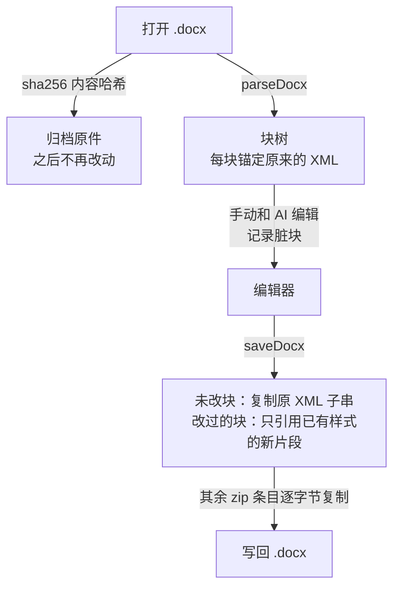

<p align="center">
  
</p>

<h1 align="center">TeleOffice</h1>

<p align="center"><b>本机就能做、改、互转 Word、Excel、PowerPoint 和 PDF 的开源 AI 办公套件。</b><br>
桌面应用、<code>teleoffice</code> 命令行和 MCP 共用同一套引擎，输出的仍是原生 Office 文件。</p>

<p align="center">
  <a href="LICENSE"></a>
  <a href="https://github.com/tyonger-stack/Teleoffice/stargazers"></a>
  
  <a href="https://github.com/genspark-ai/genoffice"></a>
  
</p>

<p align="center">
  <a href="#快速上手"><b>快速上手</b></a> ·
  <a href="#命令速查"><b>命令速查</b></a> ·
  <a href="#格式支持矩阵"><b>格式矩阵</b></a> ·
  <a href="#mcp-server"><b>助手与 MCP</b></a> ·
  <a href="#架构与调用链"><b>架构</b></a> ·
  <a href="#和上游-genoffice-的差异"><b>与上游的差异</b></a> ·
  <a href="PRIVACY.md"><b>隐私</b></a>
  <!-- 待确认：官网与社区链接（teleoffice.ai 目前无法访问）
  · <a href="https://teleoffice.ai/"><b>官网</b></a> ·
  <a href="https://teleoffice.ai/join"><b>社区</b></a>
  -->
</p>

TeleOffice 是 [genspark-ai/genoffice](https://github.com/genspark-ai/genoffice) 的定制版，以 Apache-2.0 开源。在上游的基础上，它把本机的 `mmx` / `agy` 命令行设为搜索和媒体的默认服务商，增加了企业品牌 PPT 模板模式，并把命令、目录和品牌统一改为 TeleOffice。

<details>
<summary><b>目录</b></summary>

- [快速上手](#快速上手)
- [能做什么](#能做什么)
- [命令速查](#命令速查)
- [格式支持矩阵](#格式支持矩阵)
- [JSON 输出与退出码](#json-输出与退出码)
- [无头环境（xvfb-run）](#无头环境xvfb-run)
- [编程助手与 MCP 接入](#command-line-and-agent-skill)
- [AI 服务商路由](#ai-服务商路由)
- [企业品牌模板](#企业品牌模板)
- [架构与调用链](#架构与调用链)
- [和上游 genoffice 的差异](#和上游-genoffice-的差异)
- [安装与构建](#download)
- [常见问题](#常见问题)
- [致谢与许可](#致谢与许可)

</details>

## 快速上手

装好 TeleOffice 之后，`teleoffice` 就在应用里（Linux：`/opt/TeleOffice/resources/cli/teleoffice`；macOS：`/Applications/TeleOffice.app/Contents/Resources/cli/teleoffice`）。`teleoffice install-cli` 会把它链接到 `/usr/local/bin`。

```bash
teleoffice --version                                         # teleoffice 0.11.0
teleoffice create --type docx --from report.md --out report.docx
teleoffice convert report.docx --to pdf                      # 写出 report.pdf
teleoffice render report.docx --out shots/                   # 每页一张 PNG：shots/report-01.png
teleoffice create --type xlsx --from table.json --out sales.xlsx   # "=SUM(B2:B3)" 写成公式
teleoffice convert report.pdf --to docx --out report-from-pdf.docx
```

`table.json` 是二维数组，例如 `[["地区","订单额"],["华东",49300],["华北",43250],["合计","=SUM(B2:B3)"]]`。以 `=` 开头的字符串写成会重新计算的公式，同时带上缓存值。

> [!NOTE]
> 转 PDF、`render` 和 HTML ↔ Word 会在后台启动一个不显示窗口的 TeleOffice 进程。Linux 服务器或容器没有显示器时，要用 `xvfb-run` 包一层，见[无头环境](#无头环境xvfb-run)。

## 能做什么

| 编辑器       | 打开并保存                         | AI 面板做什么                                  | 命令行对应                       |
| ------------ | ---------------------------------- | ---------------------------------------------- | -------------------------------- |
| **Docs**     | `.docx`（没改的部分按字节保留）    | 总结、润色、续写、填占位符；修改以修订痕迹出现 | `docs read/apply/check`          |
| **Sheets**   | `.xlsx`、`.xlsm`；导入 csv/xls/ods | 写入会重新计算的公式和图表                     | `sheet read/apply/check`         |
| **Slides**   | `.pptx`                            | 改标题和要点、配图、检查错别字                 | `slides …`、`create --type pptx` |
| **PDF**      | `.pdf`（页内改字、改图）           | 总结全文、提取要点；本机转 Word/Excel/PPT      | `pdf read`、`convert`            |
| **HTML**     | 单文件 `.html`                     | 提炼设计简报、换配色、统一风格；导出 Word      | `convert --to docx/pdf`          |
| **Markdown** | `.md`                              | 选中后改写、精简、扩写；导出 Word              | `convert`、`create --from`       |

首页还会给文件夹里的文档建本机全文索引（SQLite，支持中文），可以按正文搜索；需要时可把前 20 条命中片段交给 TypeSafe Jev 重排（默认关闭）。

<!-- 界面截图：应用图标替换后重新录制，再放回本节（布局与图注见维护说明）。 -->

## 命令速查

每条命令都可以加 `--json`；`teleoffice <命令> --help` 给出完整选项。「应用进程」一列表示会在后台启动隐藏的 TeleOffice；「联网」一列表示会把查询或文件发给 TeleOffice 里配置的服务商。

| 命令           | 做什么                                                               | 示例                                                             | 应用进程 | 联网 |
| -------------- | -------------------------------------------------------------------- | ---------------------------------------------------------------- | :------: | :--: |
| `info`         | 元数据和结构摘要（标题、块、表格、页数、幻灯片）                     | `teleoffice info report.docx --json`                             |          |      |
| `convert`      | 格式互转，见[格式支持矩阵](#格式支持矩阵)                            | `teleoffice convert report.docx --to pdf`                        |  部分 ¹  |      |
| `create`       | 从 Markdown / HTML / CSV / JSON / 规格文件新建 docx、xlsx、pptx、pdf | `teleoffice create --type docx --from notes.md --out notes.docx` |  部分 ¹  |      |
| `docs`         | 读取或编辑 `.docx`（与应用内 AI 相同的 ops）                         | `teleoffice docs apply report.docx --ops edits.json`             |          |      |
| `sheet`        | 读取或编辑 `.xlsx`                                                   | `teleoffice sheet read sales.xlsx --range A1:B4 --json`          |          |      |
| `slides`       | 读取、编辑、审计、渲染 `.pptx`；检查大纲和页面规格；重建单页         | `teleoffice slides audit deck.pptx`                              | `render` |      |
| `merge`        | 用 JSON 填充 docx / pptx / xlsx 模板里的 `{{key}}`                   | `teleoffice merge tpl.docx --data data.json --out out.docx`      |          |      |
| `pdf`          | 按页读取 PDF 文本层，不启动应用                                      | `teleoffice pdf read report.pdf --json`                          |          |      |
| `render`       | 每页一张 PNG，供助手检查版面                                         | `teleoffice render report.docx --out shots/`                     |  非 PDF  |      |
| `guide`        | 打印 ops 参考和版式指南                                              | `teleoffice guide slides spec`                                   |          |      |
| `template`     | 查看和管理企业 `.pptx` 模板及默认模板                                | `teleoffice template list`                                       |          |      |
| `search`       | 网页或图片搜索                                                       | `teleoffice search "季度经营数据" --max 5 --json`                |          |  ✓   |
| `image`        | 按提示词生成图片                                                     | `teleoffice image "…" --aspect 16:9 --out cover.jpg`             |          |  ✓   |
| `media`        | 描述或回答关于图片、视频、音频的问题                                 | `teleoffice media photo.jpg --ask "这是实拍吗？"`                |          |  ✓   |
| `tts` / `asr`  | 语音合成 / 语音识别                                                  | `teleoffice asr meeting.m4a`                                     |          |  ✓   |
| `video`        | 生成视频，查询任务并下载                                             | `teleoffice video "…" --out clip.mp4`                            |          |  ✓   |
| `open`         | 在 TeleOffice 里打开文件，可选中某页、某块或某个区域                 | `teleoffice open deck.pptx --slide 2`                            |    ✓     |      |
| `selection`    | 读出用户在编辑器里选中的内容                                         | `teleoffice selection report.docx --json`                        |    ✓     |      |
| `capabilities` | 这台机器配置了哪些联网能力、应用是否安装                             | `teleoffice capabilities --json`                                 |          |      |
| `mcp`          | 以 MCP 服务器运行，或把它登记到编程助手                              | `teleoffice mcp` · `teleoffice mcp list`                         |          |      |
| `skill`        | 列出本机的编程助手，安装或更新 skill                                 | `teleoffice skill list`                                          |          |      |
| `install-cli`  | 把 `teleoffice` 放进 PATH                                            | `teleoffice install-cli`                                         |          |      |

¹ 需要页面排版的路线（→ PDF、docx → html、html → docx、`create --type pdf`、`create --type pptx --render`）会启动隐藏的应用进程，其余在命令行进程内完成。

`teleoffice` 本身不调用大模型：思考交给助手，构建和检查交给 CLI。

## 格式支持矩阵

取自 `teleoffice convert --help`。● 由命令行完成，不需要显示器（xlsx / xls 相关经 Rust sidecar）；○ 由隐藏的应用进程完成，需要显示器或 `xvfb-run`。

| 源格式 \ 目标     | docx | xlsx | pptx | pdf | md  | html | csv |
| ----------------- | :--: | :--: | :--: | :-: | :-: | :--: | :-: |
| **pdf**           |  ●   |  ●   |  ●   |     |     |      |     |
| **docx**          |      |      |      |  ○  |  ●  |  ○   |     |
| **xlsx / xlsm**   |      |      |      |  ○  |     |      |  ●  |
| **xls**           |      |  ●   |      |  ○  |     |      |     |
| **xlsb / ods**    |      |  ●   |      |     |     |      |     |
| **csv**           |      |  ●   |      |  ○  |     |      |     |
| **pptx**          |      |      |      |  ○  |     |      |     |
| **md / markdown** |  ●   |      |      |  ○  |     |  ●   |     |
| **html / htm**    |  ○   |      |      |  ○  |     |      |     |

`create` 新建文件的来源：

| `--type` | 来源                                                                                      |
| -------- | ----------------------------------------------------------------------------------------- |
| `docx`   | `--from` `.md`，或受限 HTML 片段 `.html`（见 `teleoffice guide docs`）                    |
| `xlsx`   | `--from` `.csv`，或 `.json`（二维数组或 `{ "sheets": [...] }`）                           |
| `pptx`   | `--ops`（对空白文稿依次执行的 ops）或 `--spec`（1280×720 画布上的页面规格，单文件或目录） |
| `pdf`    | `--from` 任意 `.md` / `.html` / `.docx` / `.xlsx` / `.pptx`，由应用渲染打印               |

## JSON 输出与退出码

默认每条命令打印一行摘要和缩进的明细。加 `--json` 后，标准输出只有一个 JSON 对象：

```jsonc
// 成功
{ "status": "ok", "command": "convert", "summary": "converted report.docx → report.pdf",
  "output_path": "/…/report.pdf", "detail": { "via": "teleoffice --headless-export" } }
// 失败：程序按 error 分支，人读 message
{ "status": "error", "command": "convert", "code": 1, "error": "unsupported",
  "message": "cannot convert .docx to .xlsx", "suggestion": "pick a route from detail.supported" }
```

| 退出码 | 含义       | 常见 `error`                                                        |
| :----: | ---------- | ------------------------------------------------------------------- |
|   0    | 成功       | —                                                                   |
|   1    | 用法错误   | `unsupported`（不支持的转换路线）、`unknown_op`、`missing_argument` |
|   2    | 文件问题   | `file_not_found`                                                    |
|   3    | 转换失败   | `conversion_failed`（包括导出超过 180 秒）                          |
|   4    | 应用不可用 | `app_unavailable`、`app_crashed`（例如没有显示器）                  |

`docs` / `sheet` / `slides apply --ops` 的批量编辑默认是原子的：有一个 op 被拒绝，文件就不改，并返回每个失败 op 的原因和可选值。`--best-effort` 或 `--stop-on-error` 会写入已成功的部分，`status` 为 `"partial"`；`--dry-run` 只校验不写。

## 无头环境（xvfb-run）

`info`、`docs`、`sheet`、`pdf read`、`create --type docx/xlsx/pptx` 以及 pdf → Office 的转换都在命令行进程里完成，不需要显示器。需要页面排版的路线会以 `--headless-export` 启动同一个 TeleOffice 二进制：不开窗口，导出一个文件，在标准输出打印一行 JSON，然后退出。

Electron 在 Linux 上仍然需要 X 显示。在没有显示器的服务器、容器或 CI 里，直接调用会以退出码 4 失败（`app_crashed`，stderr 里是 `Missing X server or $DISPLAY`）。用 `xvfb-run` 包一层即可：

```bash
sudo apt install xvfb
xvfb-run -a teleoffice convert report.docx --to pdf
xvfb-run -a teleoffice mcp --http 3093 --host 0.0.0.0 --token "$TELEOFFICE_MCP_TOKEN"
```

也可以写一个包装脚本放进 PATH，每次都带上虚拟显示：

```sh
#!/bin/sh
exec xvfb-run -a /opt/TeleOffice/resources/cli/teleoffice "$@"
```

找不到应用时，用 `TELEOFFICE_APP_BIN` 指向 TeleOffice 可执行文件。单次导出超过 180 秒会被终止，返回退出码 3。

<a id="command-line-and-agent-skill"></a>

## 编程助手与 MCP 接入

同一套命令有两种交给助手的方式：能开终端的助手装 **skill**，直接调用 `teleoffice`；不能或不想给终端的助手接 **MCP**。

### 安装 skill

| 方式                                      | 效果                                                                 |
| ----------------------------------------- | -------------------------------------------------------------------- |
| 应用里的 **设置 → 集成**                  | 列出本机检测到的助手，点一下就写入 skill；有新版时显示「更新」。     |
| `teleoffice skill install <agent\|all>`   | 命令行里做同样的事；`teleoffice skill list` 查看每个助手的安装状态。 |
| `npx skills add tyonger-stack/Teleoffice` | 从本仓库的 `skills/teleoffice/SKILL.md` 安装到兼容 skills 的助手。   |
| 设置 → 集成里的 **下载 skill（zip）**     | 给 claude.ai、Claude 桌面应用等需要上传目录的助手。                  |

支持 Claude Code、Codex、Cursor、Gemini CLI、GitHub Copilot、OpenCode 和 Windsurf。装好后新开一个对话，直接说需求即可，例如「把 ~/Downloads/report.md 转成 Word 文档」。

做演示文稿时，助手按 skill 的分阶段流程推进，CLI 在每一步做检查：

```bash
teleoffice capabilities --json                        # 这台机器配了哪些联网能力
teleoffice guide slides design                        # 版式库和设计规则
teleoffice slides check deck/outline.json --json      # 先检查大纲
teleoffice slides check deck/pages/01.json --json     # 每页一个文件，检查溢出、重叠和配色
teleoffice create --type pptx --spec deck/pages --outline deck/outline.json --out deck/deck.pptx --json
teleoffice slides render deck/deck.pptx --out deck/shots --json
teleoffice slides audit deck/deck.pptx --json
teleoffice slides replace deck/deck.pptx --slide 4 --spec deck/pages/05.json --json
```

<a id="mcp-server"></a>

### MCP 服务器

| 方式                             | 内容                                                                                                                                                                                                                                                                                                                                                |
| -------------------------------- | --------------------------------------------------------------------------------------------------------------------------------------------------------------------------------------------------------------------------------------------------------------------------------------------------------------------------------------------------- |
| **A · `teleoffice mcp`**（推荐） | 助手自己启动的 stdio 服务，应用不必开着。共 34 个工具：`info`、`convert`、`create_docx/xlsx/pptx/pdf`、`docs_*`、`sheet_*`、`slides_*`、`merge`、`pdf_read`、`render`、`guide`、`template_list/inspect`、`capabilities`、`search`、`image`、`media`、`open`、`selection`，以及分阶段做文稿的 `deck_start → deck_page → deck_build → deck_replace`。 |
| **B · 应用内 HTTP 服务**         | 运行在 TeleOffice 里，`http://127.0.0.1:3093/mcp`（Streamable HTTP，兼容旧的 SSE），在一个看得见的 Word 标签里生成文档。默认关闭，在 设置 → 集成 → MCP 打开。                                                                                                                                                                                       |
| **C · `teleoffice mcp --http`**  | 把 A 的工具以 Streamable HTTP 提供给其他机器。`PUT /files/<name>` 上传文件并返回 URL，工具的 `file` 参数接受 http(s) URL，输出以下载链接返回。默认只监听 127.0.0.1。                                                                                                                                                                                |

```bash
# 登记到助手（Claude Code、Codex、Cursor、Gemini CLI、Copilot CLI、OpenCode、Windsurf）
teleoffice mcp install claude-code        # 或 all；teleoffice mcp list 查看状态
claude mcp add --transport stdio teleoffice -- teleoffice mcp   # 也可以手动加
```

```jsonc
// Cursor、Claude Desktop 或其他 MCP 客户端
{ "mcpServers": { "teleoffice": { "command": "teleoffice", "args": ["mcp"] } } }
```

```bash
# 远程：服务器上（无显示器时加 xvfb-run -a）
teleoffice mcp --http 3093 --host 0.0.0.0 --token "$TELEOFFICE_MCP_TOKEN"
# 客户端先上传，再把返回的 URL 交给工具
curl -T report.docx -H "Authorization: Bearer $TELEOFFICE_MCP_TOKEN" http://server:3093/files/
#   → {"url":"http://server:3093/files/<id>/report.docx","name":"report.docx","size":3958}
```

HTTP 模式下每个会话有自己的临时目录，不提供 `open`；没有设置 `TELEOFFICE_ALLOWED_ROOTS` 时，工具不能离开服务器自己的文件区。带 `--token`（或 `TELEOFFICE_MCP_TOKEN`）后，没有令牌的请求返回 401。

<table>
<tr>
<td width="50%"></td>
<td width="50%"></td>
</tr>
<tr>
<td><sub><b>设置 → 集成 → CLI · 命令行 + skill。</b>三步说明（选接法、接好、新开对话），本机检测到 Cursor 并提供「安装」，下面是「试一试」示例提示。</sub></td>
<td><sub><b>设置 → 集成 → MCP。</b>「由助手启动（推荐）」：Claude Code 的 <code>claude mcp add</code> 命令，以及 Cursor、Claude Desktop 用的 <code>mcpServers</code> JSON，都带复制按钮。</sub></td>
</tr>
</table>

## AI 服务商路由

**默认走本机命令行。** 在「设置 → 生图、媒体与搜索」里没有另选服务商时，网页搜索用这台电脑上的两个命令行：查询里有汉字、或提到 `.cn`、百度、知乎等国内站点时走 MiniMax CLI（`mmx`），其余走 Antigravity CLI（`agy`），一方失败就换另一方。生图、图片/音视频解析和语音识别先试 `agy` 再试 `mmx`；语音合成和视频用 `mmx`。



`--via mmx|agy`（或 `--region cn|intl`）可以强制指定。`detail.method` 给出实际用到的后端，`detail.attempts` 记下失败的尝试。

**自带密钥。** 「设置 → AI 模型」支持 Claude、OpenAI、Gemini、DeepSeek、Kimi、GLM、Qwen、Doubao、MiniMax、Grok、Mistral、OpenRouter、Requesty、Opper、OpenCode Zen/Go，以及任何 OpenAI 兼容端点（包括本机模型服务）。网页搜索可改用 Serper、Serply、Tavily、Parallel、Exa 或 Firecrawl 的密钥；生图和媒体解析也能分别指定服务商。

<p align="center">
  <br>
  <sub>设置 →「生图、媒体与搜索」：网络搜索为 Local CLIs（auto：中文走 mmx、其余走 agy），本机文件搜索的「Jev 搜索重排」已打开、端点为 OpenRouter，生图使用 Antigravity CLI（agy）。</sub>
</p>

## 企业品牌模板

把企业自己的 `.pptx` 模板登记一次，之后命令行和桌面应用新建的文稿都会套用它的母版、版式和字体。

```bash
teleoffice template inspect brand.pptx                      # 母版、版式、占位符、主题色和字体
teleoffice template add brand brand.pptx --copy --default   # 登记并设为默认
teleoffice template list                                    # brand (default)
teleoffice create --type pptx --spec deck/pages --out deck.pptx   # 摘要：using default template brand
teleoffice create --type pptx --spec deck/pages --out plain.pptx --no-template
teleoffice template default --clear
```

- 模板登记在 `~/.teleoffice/templates/templates.json`，可用 `TELEOFFICE_TEMPLATES_DIR` 改目录；`teleoffice template path` 打印当前位置。
- 只有页面里写的版式名和默认模板兼容时才会自动套用。没写版式的页面优先选样例里用过、内容占位符较少的标题版式，其次选装饰较丰富的简洁标题版式。
- 显式的 `--template`、规格或大纲里的 `template` 字段优先于默认模板；`--ops` 方式不受影响。
- 首页的「PPT 模板」卡片可以设置或清除默认模板，MCP 的 `template_list` 会标出默认项。

## 架构与调用链

七个 Electron 应用（Docs、Sheets、Slides、PDF、Markdown、HTML 和多标签外壳）、`teleoffice` 命令行和 MCP 服务器共用一层 TypeScript 引擎；`.xlsx` 的读取、重算和旧格式转换交给 Rust 写的 sidecar。原始文件始终是事实来源，修改以窄补丁写回。

**命令行与 MCP**：`teleoffice mcp` 把每个工具调用转成一次进程内的 CLI 调用；CLI 能在本进程完成的就直接 import 引擎，其余交给子进程。



**桌面应用**：外壳和各编辑器在同一个 Electron 主进程里，隐藏应用进程就是同一个二进制带上 `--headless-export` 启动。



| #   | 调用                       | 机制                                                                                           | 源码                                                                                                                                           |
| --- | -------------------------- | ---------------------------------------------------------------------------------------------- | ---------------------------------------------------------------------------------------------------------------------------------------------- |
| 1   | MCP 工具 → CLI 命令        | 每次工具调用都在同一进程里执行 `runCli([...argv, '--json'])`                                   | `packages/cli/src/mcp/run.ts:64`、`packages/cli/src/cli.ts:98`                                                                                 |
| 2   | stdio / HTTP 传输          | `StdioServerTransport`；`--http` 用 `StreamableHTTPServerTransport` 加 `node:http`             | `packages/cli/src/mcp/server.ts:213`、`packages/cli/src/mcp/http.ts:110`、`:291`                                                               |
| 3   | `convert` 路由             | `NODE_ROUTES` 在进程内；`APP_ROUTES` 交给隐藏应用进程                                          | `packages/cli/src/commands/convert.ts:15`、`:33`、`:122`                                                                                       |
| 4   | CLI → 隐藏应用进程         | `spawn(<app>, ['--headless-export', in, '--to', fmt, '--out', out, '--json'])`，默认超时 180 s | `packages/cli/src/formats/app-export.ts:48`、`:60`                                                                                             |
| 5   | 找应用可执行文件           | `TELEOFFICE_APP_BIN` → 宿主 Electron → 开发检出 → `/opt/TeleOffice/teleoffice` 等安装位置      | `packages/cli/src/resources.ts:99`                                                                                                             |
| 6   | 外壳进入无头模式           | 模块加载时解析 argv，设无头标志、隐藏 Dock，执行一次导出后退出                                 | `apps/shell/src/main/index.ts:375`、`:5691`、`apps/shell/src/main/headless-export.ts:86`                                                       |
| 7   | 无头导出支持的目标         | `HEADLESS_TARGETS`，以及 `--headless-export` 标志的定义                                        | `packages/electron-utils/src/headless-export.ts:23`、`:39`                                                                                     |
| 8   | `render`                   | 非 PDF 先经第 4 行导出 PDF，再由 PDFium 光栅化                                                 | `packages/cli/src/formats/render.ts:80`、`packages/cli/src/commands/render.ts:131`                                                             |
| 9   | CLI → Rust sidecar         | 每次调用起一个短命进程，用完即停                                                               | `packages/cli/src/formats/xlsx.ts:41`、`:186`                                                                                                  |
| 10  | sidecar 协议               | `spawn(binary, [], { stdio: pipe })`，stdin 写入逐行 JSON 请求，readline 读回应答              | `apps/sheets/src/main/xlsx-sidecar-client.ts:184`、`:240`                                                                                      |
| 11  | sidecar 本体               | crate `xlsx-sidecar`，依赖 calamine 0.36 与 IronCalc 0.7                                       | `apps/sheets/native/xlsx-engine/Cargo.toml:2`、`:10`、`:11`                                                                                    |
| 12  | 外壳加载编辑器             | 外壳主进程直接 import Docs、Sheets 等编辑器的主进程模块；Sheets 持有长驻的 `XlsxSidecarClient` | `apps/shell/src/main/index.ts:144`、`:189`、`apps/sheets/src/main/sheets-main.ts:1612`                                                         |
| 13  | CLI → 引擎                 | docx 用 `docx-engine`，pdf → Office 用 `pdf2docx`                                              | `packages/cli/src/formats/docx.ts:25`、`packages/cli/src/formats/pdf.ts:10`                                                                    |
| 14  | docx 窄补丁保存            | 原件按内容哈希归档；未改块按原 XML 子串复制，其余 zip 条目原样复制                             | `apps/docs/src/main/docs-main.ts:3255`、`packages/docx-engine/src/patch.ts:597`                                                                |
| 15  | 搜索默认服务商             | 没设置或旧的 `genspark` 都映射为 `local-cli`                                                   | `packages/ai-provider/src/search-settings.ts:80`、`packages/ai-search/src/search-tools.ts:23`                                                  |
| 16  | mmx / agy 选择与回退       | `pickSearchProvider` → `isDomesticQuery`（汉字或国内站点）；`fallback` 默认开                  | `packages/ai-search/src/index.ts:406`、`:408`、`packages/ai-search/src/local-cli.ts:1493`、`:1516`、`packages/ai-provider/src/providers.ts:20` |
| 17  | 本机 CLI 调用              | `child_process.spawn`，参数数组，不经 shell                                                    | `packages/ai-search/src/local-cli.ts:97`、`:717`（agy）、`:1193`（mmx）                                                                        |
| 18  | 免费兜底链                 | gsk（条件触发）→ Parallel MCP → DuckDuckGo                                                     | `packages/ai-search/src/index.ts:428`、`:435`、`:438`                                                                                          |
| 19  | 生图 / 媒体回退顺序        | `['antigravity', 'mmx']`，主选 mmx 时对调                                                      | `packages/ai-search/src/media-tools.ts:304`                                                                                                    |
| 20  | 模板目录                   | `TELEOFFICE_TEMPLATES_DIR`（兼容 `GENOFFICE_TEMPLATES_DIR`）或 `~/.teleoffice/templates`       | `packages/pipelines/src/slides/template-registry.ts:64`、`:289`、`:562`                                                                        |
| 21  | `create --spec` 套默认模板 | 版式名兼容时选默认模板，再由 `buildTemplateDeck` 构建                                          | `packages/cli/src/commands/create.ts:324`、`packages/cli/src/formats/slide-spec.ts:623`、`packages/pipelines/src/slides/template.ts:1218`      |
| 22  | 桌面首页模板卡片           | 主进程调用同一注册表设置默认模板                                                               | `apps/shell/src/main/slide-templates.ts:49`                                                                                                    |
| 23  | 应用内 MCP                 | 默认端口 3093，同时提供 Streamable HTTP 与旧 SSE                                               | `apps/shell/src/main/mcp/mcp-server.ts:49`                                                                                                     |
| 24  | `ee/` 企业模块（规划中）   | 目前只有说明和许可证，留给以后的私有部署、离线授权等                                           | `ee/README.md`                                                                                                                                 |

`.docx` 的保存方式：



各个包的说明见 [CONTRIBUTING.md](CONTRIBUTING.md#engine-packages)。

## 和上游 genoffice 的差异

| 方面           | genspark-ai/genoffice                 | TeleOffice                                                                                        |
| -------------- | ------------------------------------- | ------------------------------------------------------------------------------------------------- |
| 命令与目录     | `genoffice`、`~/.genoffice`           | `teleoffice`、`~/.teleoffice`；仍认 `GENOFFICE_*` 环境变量；安装时移除旧的 `genoffice` Linux 链接 |
| 搜索与媒体默认 | Genspark 登录后的云端工具，或自带密钥 | 本机 `mmx` / `agy` 命令行，互为回退；搜索、生图、媒体解析、TTS、ASR、视频都可走本机               |
| PPT 模板       | —                                     | 企业品牌模板：`template add/default/list`，`create --spec` 自动套用，首页模板卡片                 |
| 账号与统计     | Genspark 登录、Projects、使用统计     | 去掉登录按钮、Projects 和使用统计模块，账号改为本机邮箱                                           |
| 品牌           | GenOffice                             | TeleOffice 名称、应用图标，默认保存目录 `<文稿>/TeleOffice`                                       |
| 与上游同步     | —                                     | 按提交挑选合入；CI 定期报告上游的新提交但不自动合并（`tools/upstream-synced-through.txt`）        |

## 安装与构建

<a id="download"></a>

预编译安装包的发布方式还没有确定，目前可以从源码构建。

<!-- 待确认：Release 发布后恢复下载表
| 平台                                  | 系统要求                                               | 下载                                                                                      |
| ------------------------------------- | ------------------------------------------------------ | ----------------------------------------------------------------------------------------- |
| **macOS** —— Apple Silicon (arm64)    | macOS 11+                                              | [最新 `.dmg`（arm64）](https://github.com/tyonger-stack/Teleoffice/releases/latest)       |
| **macOS** —— Intel (x64)              | macOS 11+                                              | [最新 `.dmg`（x64）](https://github.com/tyonger-stack/Teleoffice/releases/latest)         |
| **Windows**（x64，大多数 PC）         | Windows 10+，Intel/AMD                                 | [最新 `-x64.exe` 安装程序](https://github.com/tyonger-stack/Teleoffice/releases/latest)   |
| **Windows** on Arm（ARM64）           | Windows 11 on Arm（Snapdragon X 及同类芯片）           | [最新 `-arm64.exe` 安装程序](https://github.com/tyonger-stack/Teleoffice/releases/latest) |
| **Linux** —— Debian / Ubuntu          | x86_64，glibc 2.34+（Ubuntu 22.04 或更新）             | [最新 `.deb`](https://github.com/tyonger-stack/Teleoffice/releases/latest)                |
| **Linux** —— Fedora / RHEL / openSUSE | x86_64，glibc 2.34+（Fedora 35+、RHEL 9+、Leap 15.6+） | [最新 `.rpm`](https://github.com/tyonger-stack/Teleoffice/releases/latest)                |
| **Linux** —— 其他发行版               | x86_64，glibc 2.34+，FUSE 2                            | [最新 `.AppImage`](https://github.com/tyonger-stack/Teleoffice/releases/latest)           |

旧版本在 [Releases](https://github.com/tyonger-stack/Teleoffice/releases)。
-->

```bash
npm install          # Node >= 22.12，npm >= 10
npm run fixtures     # 生成测试用的 .docx
npm test             # 各引擎和应用的单元测试
npm run typecheck    # 每个工作区 tsc --noEmit
npm run dev          # 六个编辑器加外壳，对着 Vite 开发服务器
npm run dist:linux   # 打 Linux AppImage、deb 和 rpm（dist:mac / dist:win 同理）
```

Sheets 的 xlsx sidecar 需要 Rust 工具链（`cargo` 在 PATH 里），`npm run build -w @teleoffice/sheets` 会编译它。

<details>
<summary><b>Linux 上安装打好的包</b></summary>

```bash
sudo apt install ./teleoffice_<version>_amd64.deb      # Debian / Ubuntu
sudo dnf install ./teleoffice-<version>.x86_64.rpm     # Fedora / RHEL 系列
sudo zypper install ./teleoffice-<version>.x86_64.rpm  # openSUSE
chmod +x TeleOffice-<version>.AppImage && ./TeleOffice-<version>.AppImage   # 需要 FUSE 2
```

</details>

## 常见问题

<details>
<summary><b>能打开 Microsoft Word、Excel 和 PowerPoint 文件吗？</b></summary>

可以。TeleOffice 打开并保存原生 `.docx`、`.xlsx` 和 `.pptx`，没改过的部分逐字节写回，文件在 Microsoft Office 里照常可用。

</details>

<details>
<summary><b>可以离线使用吗？</b></summary>

编辑、保存和转换都在本机完成，不会把文件发出去。`search`、`image`、`media`、`tts`、`asr`、`video` 和应用里的 AI 助手需要网络，以及本机命令行或你自己的模型密钥。

</details>

<details>
<summary><b>PDF 能编辑、能转成 Office 吗？</b></summary>

可以。页内改字和改图会重写页面内容流并保留原字体。PDF → Word / Excel / PowerPoint 在本机完成：PDFium 做字符级提取，再按几何信息分析版面。macOS 和 Windows 上扫描页由系统 OCR 识别。

</details>

<details>
<summary><b>服务器上没有显示器能用吗？</b></summary>

能。大多数命令不需要显示器；转 PDF、`render` 和 HTML ↔ Word 需要用 `xvfb-run -a` 包一层，见[无头环境](#无头环境xvfb-run)。

</details>

<details>
<summary><b>会收集数据吗？</b></summary>

不发送匿名使用统计。只有使用 AI 功能时，提示词和所需的文档上下文才会发给你配置的服务商。详见[隐私政策](PRIVACY.md)，进程隔离和威胁模型见 [SECURITY.md](SECURITY.md)。

</details>

## 致谢与许可

TeleOffice 基于 [genspark-ai/genoffice](https://github.com/genspark-ai/genoffice) 定制，以 [Apache License 2.0](LICENSE) 发布。按 [NOTICE](NOTICE)：

- Copyright 2026 Mainfunc, Inc.。This product includes software developed at Mainfunc, Inc.
- 随应用打包的第三方组件列在 `THIRD-PARTY-NOTICES.txt` 里，打包时由 `tools/gen-third-party-notices.mjs` 生成（`npm run notices`），不放进仓库。随附字体的许可见 `apps/docs/src/renderer/fonts/README.md`。
- `apps/pdf/src/shared/radicals.ts` 由 Unicode Character Database 17.0.0 生成，适用 Unicode License v3，见 [LICENSE-UNICODE.txt](LICENSE-UNICODE.txt)。
- `tools/ooxml-validate/schemas` 收录 ISO/IEC 29500-4:2016 的 XML Schema，只用于测试和开发工具，不随应用发布。
- 例外是 `ee/` 目录：它留给以后的企业模块，适用 [ee/LICENSE](ee/LICENSE)，不在 Apache-2.0 范围内。

TeleOffice 用到这些开源项目：

<details>
<summary><b>第三方组件</b></summary>

- [Electron](https://www.electronjs.org/) —— 每个应用的桌面运行时。
- [Univer](https://github.com/dream-num/univer)（Apache-2.0）—— Sheets 的电子表格界面内核。
- [PDFium](https://pdfium.googlesource.com/pdfium/)（BSD-3-Clause，经 [@embedpdf/pdfium](https://github.com/embedpdf/embed-pdf-viewer) 打包）—— PDF 文字和图片编辑的内容流引擎。
- [pdf.js](https://github.com/mozilla/pdf.js)（Apache-2.0）和 [pdf-lib](https://github.com/Hopding/pdf-lib)（MIT）—— PDF 渲染和组装。
- [Tiptap](https://tiptap.dev/) / [ProseMirror](https://prosemirror.net/) —— Docs 和 Markdown 的块编辑器。
- [CodeMirror](https://codemirror.net/)（MIT）—— HTML 源码编辑器。
- [Konva](https://konvajs.org/) —— Slides 和 Sheets 图表的画布渲染。
- [HarfBuzz](https://github.com/harfbuzz/harfbuzz)（wasm）—— 复杂文字整形。
- [calamine](https://github.com/tafia/calamine) 和 [IronCalc](https://github.com/ironcalc/IronCalc) —— Rust xlsx sidecar 的读取和计算。
- [libeot](https://github.com/umanwizard/libeot)（MPL-2.0）—— 嵌入式 PowerPoint 字体的 MicroType Express 解码器，已移植为 TypeScript。
- [React](https://react.dev/)（MIT）—— 各应用的界面层。
- [Mermaid](https://mermaid.js.org/)（MIT）和 [KaTeX](https://katex.org/)（MIT）—— Markdown 和 Docs 里的图和公式。
- [opentype.js](https://opentype.js.org/)（MIT）—— 字体度量和字形查找。
- [JSZip](https://stuk.github.io/jszip/)（MIT）和 [fast-xml-parser](https://github.com/NaturalIntelligence/fast-xml-parser)（MIT）—— OOXML 容器和 XML。
- [Fluent UI System Icons](https://github.com/microsoft/fluentui-system-icons)（MIT）—— 功能区图标。
- [electron-updater](https://www.electron.build/)（MIT）—— 应用内更新。
- Liberation、Carlito、Caladea 和 Noto CJK 字体（OFL / Apache-2.0）—— 随应用带上的文档字体。

</details>

欢迎在 [GitHub Issues](https://github.com/tyonger-stack/Teleoffice/issues) 报告问题或提出功能；如果 TeleOffice 对你有用，给仓库点个星是最直接的支持。贡献流程见 [CONTRIBUTING.md](CONTRIBUTING.md)。
